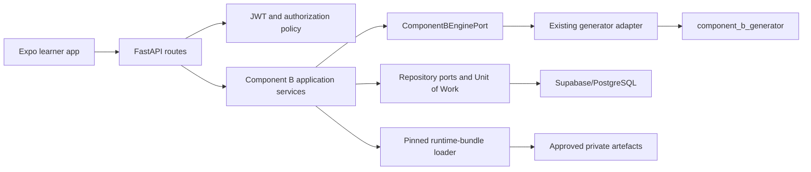
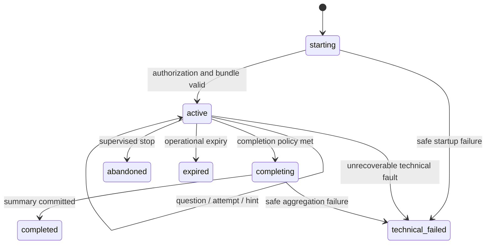
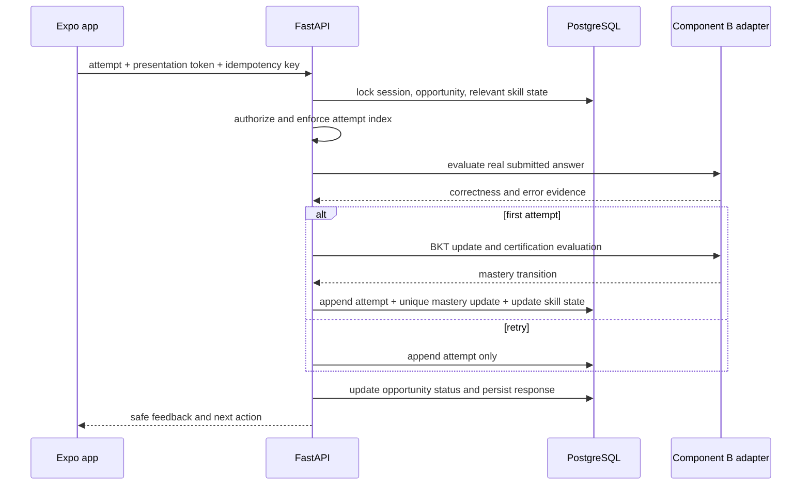
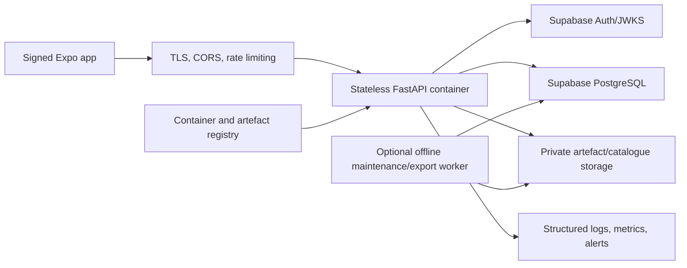

# Component B Backend Architecture

**Project:** Adaptive Math Platform  
**Component:** Component B - Personalized Mathematics Question and Mastery Engine  
**Document role:** Backend source of truth  
**Target implementation:** `Dev/backend/`  
**Backend stack:** Python, FastAPI, Pydantic v2, SQLAlchemy 2, Alembic, PostgreSQL/Supabase  
**Mobile client contract:** `Dev/frontend.md`  
**Status:** Architecture ready for implementation; scientific values retain the approval and calibration status of their source documents  
**Scope date:** 2026-07-21  
**Generator alignment:** Reuse map (§8.1) and reconciliations (§3.3) re-verified against the `component_b_generator` source snapshot on 2026-07-21 — all referenced modules/functions resolve, the `certify_skill` rule and `0.50/0.30/0.20` sequencing weights match the code, and the 29-implemented/7-deferred/36-template split is confirmed. See §3.3 for the confirmed constants.

---

## 1. Purpose

This document defines the backend for **Component B only**.

Component B is a mathematics question engine for Grade 2 and Grade 3 learners. It:

- selects a grade-valid mathematics task;
- generates a safe question from the governed catalogue;
- evaluates the child's real answer with authoritative mathematics rules;
- provides reviewed hints and bounded retries;
- records attempts and response time;
- updates one per-skill Bayesian Knowledge Tracing (BKT) state from first-attempt evidence;
- applies the per-learner guess guard before mastery certification;
- adapts the next question from the learner's own Component B history;
- produces a child-safe progress view.

The backend turns the existing `component_b_generator` scientific implementation into a durable, authenticated, transaction-safe application service. It does not replace or independently reimplement the generator's mathematics, BKT, hint, sequencing, or catalogue logic.

This document is the implementation contract for the future `Dev/backend/` folder. The existing `componantBArchi.md` remains the whole Component B application architecture, and `frontend.md` remains the frontend source of truth. Where a proposed API type differs, the final FastAPI OpenAPI contract and shared contract tests must reconcile both documents before frontend integration.

---

## 2. Strict Scope

### 2.1 Included now

- Supabase JWT verification and server-side learner authorization.
- Component B learner, session, skill-state, question, attempt, hint, mastery-update, summary, and idempotency persistence.
- Start or resume one active Component B session.
- Issue or replay one open question.
- Use the existing Component B catalogue, activation rules, samplers, answer rules, distractors, hints, BKT, guess guard, certification, sequencing, and aggregation.
- Receive **real** answers from the Expo application.
- Derive response time from server-controlled timestamps.
- Update BKT from the first attempt only.
- Return safe feedback, session recovery, completion, and progress responses.
- Pin one exact scientific/runtime bundle for an entire session.
- Liveness, readiness, structured logging, migrations, tests, deployment, backup, and rollback foundations.
- A disabled/configuration-gated cold-start bootstrap seam, while persisting the evidence needed for a later owner decision.

### 2.2 Explicitly excluded now

- Component C gameplay, engagement, frustration, learner-state, policy, or UI.
- Component 3 clustering, risk, stagnation, prediction, dashboards, or recommendations.
- Shared B+C session orchestration.
- Teacher, guardian, research, and administration portals.
- An online learning or self-deploying model.
- Direct runtime decisions based on `population`, `dd_subtype`, diagnosis, or an external cognitive profile.
- Synthetic learner truth or generated learner behaviour in the live child path.
- LLM-generated hints, web content, or unreviewed free text.
- A new BKT, correctness, misconception, hint, or sequencing algorithm.
- Enabling the draft cold-start coverage override without a governed Component B decision and versioned configuration.

### 2.3 Future integration seams

The backend may preserve narrowly typed internal adapters for the already implemented B-to-C and B-to-Component-3 contracts, but no current learner request calls Component C or Component 3.

The future B-to-C boundary remains exactly the seven approved mastery values. Attempts, hints, errors, timing, certification, observation counts, catalogue content, and sequencing evidence remain private to B unless a later governed contract explicitly changes that boundary. Per the generator (`bkt.certification`), the `certified_*` signal is exported only on the separate B→3 boundary's per-edge allow-list and is deliberately **absent** from the B→C mastery payload.

---

## 3. Source Authority and Reconciliation

### 3.1 Governing sources

Implementation must consult the active, non-archive sources in this order:

1. `Yass/Governance/` for genuine approval status.
2. `Yass/Registers_v0.3/R26-IT-138_Shared_Foundation_Decision_Register_v0.3.md`.
3. `Yass/Registers_v0.3/R26-IT-138_Component_B_Variable_Register_v0.3.md`.
4. `Yass/Component_B_Generator_v1.0/SPEC.md`.
5. `Yass/Component_B_Generator_v1.0/R26-IT-138_Component_B_Phase_B2B_Learner_Response_and_Attempt_Spec_v1.0.md`.
6. `Yass/Component_B_v1.0/R26-IT-138_Component_B_Item_and_Task_Set_Catalogue_v1.0.md`.
7. `Yass/Component_B_v1.0/R26-IT-138_Component_B_Empirical_Statistical_Parameters_v1.0.md`.
8. `Yass/Implementation_v1.0/component_b_generator/` and its Component B tests.
9. `Yass/Implementation_v1.0/R26-IT-138_Contract_Implementation_Codebase_Map_v1.0.md`.
10. `Yass/Deployment_MLOps_v1.0/R26-IT-138_Backend_Deployment_Recalibration_and_Model_Optimization_Strategy_v1.0.md`.
11. `Upadya/componantBArchi.md` and `Upadya/Dev/frontend.md` for the current application contract.

`Yass/stage/` and `Yass/Archive/` are not implementation authorities when an active equivalent exists.

### 3.2 Status must not be overstated

- D1, D2, and D3 shared governing decisions are recorded as approved.
- Component B empirical parameters are approved for **provisional v1 technical implementation**, with formal academic sign-off and calibration limitations still recorded by the source.
- The Component B catalogue contains proposal/approval wording and blank approval evidence. Its technical catalogue and current generator coverage may be used, but the backend must not invent sign-off.
- The cold-start readiness assessment is a draft for owner review and does not authorize enabling a new policy.
- Scientific defaults, thresholds, priors, and plausibility settings retain `PROVISIONAL`, `ENGINEERING_ASSUMPTION`, or `CALIBRATION_PENDING` labels where present.

### 3.3 Source conflicts

When prose, old registers, and executable code differ:

1. do not silently choose a new scientific behavior;
2. check the newest governed SPEC/build record and current tests;
3. characterize the executable behavior with a test;
4. record the difference as an implementation limitation or governance issue;
5. require an owner-approved patch before intentionally changing scientific behavior.

Known reconciliations for this backend:

- The current implementation contains phases through B6 although the package `README.md`, `__init__.py`, and version constant still describe Phase B1. Version pinning must therefore use a build manifest and source commit/checksum, not that stale phase string alone.
- The current certification function requires `p_l > theta_B` **and** guess-guard status `NOT_TRIGGERED`. Both `TRIGGERED` and `INSUFFICIENT_EVIDENCE` withhold certification. This executable rule and its tests take precedence over older wording that says thin evidence does not block.
- The current generator treats prerequisites as soft sequencing evidence after grade and implementation eligibility. Do not introduce a new hard prerequisite exclusion without a governed change.
- The old register says the item stream was not built. The current generator and its tests supersede that historical build-status statement.
- Source re-verification (2026-07-21): `component_b_generator/__init__.py` still declares `PHASE = "B1"`, `GENERATOR_PACKAGE_VERSION = "0.1.0-phase-b1"`, and `CATALOGUE_VERSION = "1.0"` despite B1–B6 code — confirming the stale-metadata reconciliation above. `bkt.certification.certify_skill` returns `p_l > theta_B AND guard_status == NOT_TRIGGERED` and is a **pure, non-sticky** function (no persisted "once-certified" flag; it silently de-certifies when either input stops satisfying the rule). `sequencing.score.score_candidate` reads the pinned `0.50/0.30/0.20` weights from `BSequencingConfig`. The seven skills are the frozen `models.contracts.SKILLS` tuple (a shared top-level `models` package alongside the generator, not `component_b_generator/models/`). All §8.1 reuse-map symbols resolve as written.

---

## 4. Non-Negotiable Component B Rules

1. The backend is authoritative for authentication, session state, question selection, timing, correctness, hint level, attempts remaining, BKT, certification, and safe progress.
2. The learner is individualized only from that learner's own Component B item-response history.
3. No cognitive-profile service or external profile changes BKT priors.
4. There are exactly seven skills:
   - `counting`
   - `number_sense`
   - `place_value`
   - `addition`
   - `subtraction`
   - `multiplication`
   - `division`
5. Grade 2 excludes multiplication and division. Grade 3 may use all seven skills.
6. One independent BKT state exists for each `(learner, skill)` pair. There is no cross-skill BKT transfer.
7. Only the first attempt on an opportunity creates a BKT observation.
8. A timeout/no-response on the first attempt is an incorrect BKT observation under the frozen current rule.
9. Retry correctness and hint-assisted correctness do not create another BKT observation.
10. `item_difficulty` may influence ordering within sequencing; it is not an input to mathematical correctness or the BKT emission formula.
11. Sequencing uses the frozen weighted sum:

```text
score = 0.50 * mastery_gap
      + 0.30 * prerequisite_readiness
      + 0.20 * spacing_due
```

12. Never-practised skills receive `spacing_due = 1.0`; missing mastery uses the configured skill `P(L0)`.
13. Hints are deterministic, catalogue-backed, teacher-reviewed levels L1, L2, and L3.
14. Public responses never include an answer key, equivalent-answer list, distractor rule, generated seed, BKT parameters, private mastery transition, sequencing score, or hidden generator state.
15. `population` and `dd_subtype` are audit-only synthetic fields and may not influence live API behavior.
16. A technical or network failure is never stored as a wrong learner response and never reduces mastery.
17. Every state-changing command is idempotent.
18. A session pins one immutable runtime bundle from start to terminal state.

The error/misconception vocabulary is exactly:

```text
correct
off_by_one
place_value
operator_confusion
transposition
fact_retrieval
timeout_no_response
random
```

---

## 5. Live Runtime Versus Synthetic Generator

The generator contains both reusable scientific functions and simulation-only behavior. They must remain separated.

| Area | Live backend | Offline/synthetic only |
|---|---:|---:|
| Catalogue loading and validation | Yes | Yes |
| Activation, grade gate, and deferred-template checks | Yes | Yes |
| Sequencing features, score, tie-break, and selection | Yes | Yes |
| Samplers and task-instance construction | Yes | Yes |
| Answer normalization/equivalence | Yes | Yes |
| Distractor construction for options | Yes | Yes |
| Reviewed catalogue hints | Yes | Yes |
| BKT update, guess guard, certification | Yes | Yes |
| Session aggregation | Through a live adapter | Yes |
| `cohort/` learner creation | No | Yes |
| Hidden truth and synthetic traits | No | Yes |
| `behaviour.first_attempt` simulated answer | No | Yes |
| `behaviour.latency` simulated response time | No | Yes |
| `behaviour.attempt_loop` simulated retries/hints | No | Yes |
| `pipeline.py`, `pilot.py`, synthetic audits | No learner request | Yes |

The live path receives observable child actions from FastAPI and persists them. It must never call the synthetic pipeline to decide what the child answered, how long the child took, whether the child requested help, or how many retries occurred.

---

## 6. Recommended Backend Architecture

### 6.1 Architectural style

Use a **Component B modular monolith** with ports and adapters:



FastAPI route handlers validate transport concerns and call one application use case. They do not contain BKT equations, answer keys, transaction orchestration, or ORM queries.

### 6.2 Proposed directory structure

```text
Dev/
|-- backend.md
|-- backend/
|   |-- app/
|   |   |-- main.py
|   |   |-- api/
|   |   |   |-- dependencies.py
|   |   |   |-- errors.py
|   |   |   |-- routes/
|   |   |       |-- me.py
|   |   |       |-- b_sessions.py
|   |   |       |-- b_questions.py
|   |   |       |-- b_attempts.py
|   |   |       |-- b_hints.py
|   |   |       |-- b_progress.py
|   |   |       `-- health.py
|   |   |-- application/
|   |   |   |-- commands/
|   |   |   |-- queries/
|   |   |   |-- dto/
|   |   |   `-- services/
|   |   |-- domain/
|   |   |   |-- enums.py
|   |   |   |-- entities.py
|   |   |   |-- policies.py
|   |   |   |-- errors.py
|   |   |   `-- ports/
|   |   |       |-- engine.py
|   |   |       |-- repositories.py
|   |   |       `-- unit_of_work.py
|   |   |-- infrastructure/
|   |   |   |-- auth/
|   |   |   |-- db/
|   |   |   |   |-- models.py
|   |   |   |   |-- repositories.py
|   |   |   |   `-- unit_of_work.py
|   |   |   |-- engine/
|   |   |   |   |-- generator_adapter.py
|   |   |   |   |-- live_answer_adapter.py
|   |   |   |   `-- safe_question_mapper.py
|   |   |   |-- runtime/
|   |   |   `-- observability/
|   |   |-- config.py
|   |   `-- lifespan.py
|   |-- migrations/
|   |-- tests/
|   |   |-- unit/
|   |   |-- contract/
|   |   |-- integration/
|   |   `-- e2e/
|   |-- pyproject.toml
|   |-- alembic.ini
|   |-- Dockerfile
|   |-- .env.example
|   `-- README.md
`-- frontend/
```

### 6.3 Dependency direction

```text
API -> application -> domain ports
infrastructure -> domain ports
generator adapter -> existing generator
domain/application -X-> FastAPI, SQLAlchemy, Supabase SDK, ORM models
```

Repositories return domain records. ORM models do not cross into use cases or public schemas.

---

## 7. Application Use Cases

| Use case | Responsibility |
|---|---|
| ResolveCurrentLearner | Verify token mapping and return the safe authorized learner view |
| StartOrResumeBSession | Reuse an active session or create one with a pinned runtime bundle |
| RecoverBSession | Reconstruct authoritative screen state without changing learning state |
| IssueNextQuestion | Replay the open opportunity or select, generate, persist, and return one safe question |
| SubmitAttempt | Validate presentation and attempt order, evaluate the real answer, persist evidence, and update BKT once |
| RequestHint | Return and persist the next allowed reviewed hint |
| CompleteBSession | Verify eligibility, aggregate canonical records, and close the session atomically |
| GetSafeProgress | Map private Component B state to non-diagnostic child-safe labels |

Every state-changing use case follows this shape:

1. authorize the current principal and learner;
2. validate the `Idempotency-Key` and canonical request hash;
3. begin one database transaction;
4. lock the smallest required current-state rows;
5. enforce lifecycle and optimistic-version preconditions;
6. call the engine through a domain port;
7. append immutable events;
8. update current projections;
9. store the exact successful response against the idempotency record;
10. commit and return a safe DTO.

---

## 8. Component B Engine Port

The application depends on an explicit port, not directly on generator modules.

```python
class ComponentBEnginePort(Protocol):
    def validate_runtime_bundle(self, bundle: RuntimeBundle) -> None: ...
    def initialize_skill_states(self, grade: int, bundle: RuntimeBundle) -> list[SkillStateInit]: ...
    def select_and_build_question(self, context: SelectionContext) -> PrivateQuestion: ...
    def map_safe_question(self, question: PrivateQuestion) -> SafeQuestion: ...
    def evaluate_real_answer(self, question: PrivateQuestion, answer: SubmittedAnswer) -> AnswerEvaluation: ...
    def get_hint(self, question: PrivateQuestion, next_level: int, attempt_index: int) -> ReviewedHint: ...
    def update_mastery(self, state: SkillState, first_attempt_correct: bool, bundle: RuntimeBundle) -> MasteryTransition: ...
    def evaluate_certification(self, context: CertificationContext) -> CertificationResult: ...
    def aggregate_session(self, context: LiveSessionAggregateContext) -> SessionAggregate: ...
```

### 8.1 Existing generator reuse map

| Port behavior | Existing implementation to reuse |
|---|---|
| Catalogue load/checksum | `catalogue.loader.load_catalogue`, `catalogue.loader.catalogue_file_checksum` |
| Activation | `generation.activation.decide_activation` → `models.task_instance.ActivationDecision` (six gate booleans + `reason`; ambiguous templates reported inactive, never invented) |
| Eligibility | `sequencing.eligibility.eligible_candidates` |
| Sequencing features | `sequencing.features.compute_features` |
| Score and deterministic tie-break | `sequencing.score.score_candidate`, `rank_candidates`, `select_target` → `SelectionResult` / `SelectionReason` |
| Select and build | `sequencing.select_item.build_task_instance_via_sequencing` |
| Direct task build | `generation.task_instances.build_task_instance` |
| Answer normalization/equivalence | `answers.rules.normalize_answer`, `answers.rules.answers_equivalent` (re-exported via the stable `answers.normalization` path) |
| Correct answer/equivalence | `answers.registry`, `answers.rules`, `answers.structured` |
| Distractors/options | `distractors.registry`, `distractors.rules` |
| Reviewed hints | `behaviour.hints.get_catalogue_hint` → `CatalogueHintReference` (single `content: str`; fail-closed `HintContentError`) |
| BKT mathematics | `bkt.update.bkt_predict`, `bkt_posterior`, `bkt_update` |
| BKT orchestration | `bkt.orchestrator.update_skill_mastery` (first-attempt event → transition; accepts generator-oriented event models) |
| Guess guard | `bkt.guess_guard.plausibility_floor`, `evaluate_guess_guard` |
| Certification | `bkt.certification.certify_skill` (pure, non-sticky; `certified_*` is a **B→3** field, not B→C) |
| Seven-skill source of truth | `models.contracts.SKILLS` (shared top-level `models` package, not `component_b_generator/models/`) |
| Aggregation | `aggregation.session.aggregate_session`, through a live compatibility adapter |
| Future governed exports | `adapters.to_c`, `adapters.to_3`; not invoked now |

### 8.2 Live answer adapter

The generator's synthetic event models are not the API. The live adapter must:

- validate the public `SubmittedAnswer` union against the issued response format;
- translate an `option_id` through the persisted private option map;
- call existing normalization and equivalence functions;
- recompute/validate the canonical answer from persisted operands rather than trusting client data;
- derive `is_correct` only from the existing answer rules;
- map a supported wrong-answer transformation to the existing error vocabulary;
- use `random` as the neutral reviewed fallback when no rule is supported;
- never expose the correct answer or error rule to the client;
- construct the canonical persisted live attempt record;
- call BKT only when `attempt_index == 1`.

The existing BKT orchestrator (`bkt.orchestrator.update_skill_mastery`) accepts generator-oriented event models. The backend may either construct the exact canonical compatible opportunity record or add a narrow adapter that feeds the persisted first-attempt boolean into the existing pure BKT functions. It must not duplicate the BKT equations.

### 8.2.1 Reviewed hint mapping

`behaviour.hints.get_catalogue_hint(catalogue, catalogue_checksum, item_template_id, hint_level)` returns a `CatalogueHintReference` whose `content` is a **single reviewed string** (the catalogue's `hint_level_1/2/3` field), with provenance fields `content_id`, `catalogue_version`, and `catalogue_checksum`. It performs a pure catalogue lookup with no LLM, network, or free-text path, and fails closed (`HintContentError`) on an unknown template, out-of-range level, or blank content. Because the public hint contract (§13.6, `frontend.md`) is a `HintContentBlock[]`, the safe mapper must wrap this single reviewed string as one hint block (never paraphrasing it) and persist the full `CatalogueHintReference` provenance on `b_hint_events`.

### 8.2.2 Live session-aggregation adapter

`aggregation.session.aggregate_session(session_identity, opportunities, skill_mastery_updates, *, guard_statuses, theta_B)` consumes **research/generator-oriented** models — `SessionIdentity` (keyed by `student_id` / `b_session_index`), `models.behaviour.BOpportunityResponseSummary`, and `models.opportunity.SkillMasteryUpdate` — and returns per-skill `SkillSessionRollup`s. The live compatibility adapter must therefore build these from the live `b_item_opportunities`, `b_attempt_events`, and `b_mastery_updates` rows, and supply `guard_statuses` / `theta_B` so certification roll-ups are computed rather than left `None`. The adapter never calls the synthetic pipeline; it only reshapes persisted live evidence into the pure aggregator's inputs.

### 8.3 Supported task coverage

The governed catalogue contains 36 templates. The current generator implements 29 and fails closed for seven deferred templates:

```text
B-CNT05-FORWARD-FROM-N
B-NS01-READ-NUMERAL
B-NS06-NUMBER-LINE
B-PV05-REGROUP-ONES
B-PV06-UNGROUP-TEN
B-SUB02-DIFFERENCE
B-DIV04-INVERSE-FACT
```

The live public API supports only the nine response formats implemented by the current sampler registry and frontend renderer plan:

```text
single_integer
single_integer_or_choice
single_choice
relation_choice
ordered_list
binary_or_choice
single_choice_or_integer
expanded_form
interactive_set_selection
```

Unknown, deferred, unimplemented, or renderer-incompatible templates are ineligible. The backend never substitutes a generic free-text question.

---

## 9. Session and Opportunity Lifecycle

### 9.1 Session states

```text
starting
active
completing
completed
abandoned
expired
technical_failed
```

Allowed transitions:



A technical failure is an operational terminal state, not a learner outcome.

### 9.2 Start or resume

1. Verify JWT signature, issuer, audience, expiry, and subject.
2. Map the subject to an active authorized learner.
3. Return the learner's existing active/starting session if present.
4. Resolve the approved runtime bundle.
5. Validate catalogue checksum, template coverage, BKT config, guess guard, certification, sequencing, and schema compatibility.
6. Initialize any missing skill states at the bundle's per-skill `P(L0)` and observation count zero.
7. Create the session with its exact runtime bundle and expiration.
8. Store the idempotent response.

### 9.3 Issue question

- Lock the active session.
- If an open opportunity exists, return the same safe DTO and presentation token.
- Load learner mastery, observation counts, practice history, grade, and pinned bundle.
- Build grade- and implementation-eligible candidates. Eligibility runs the explicit `generation.activation.decide_activation` policy (recognized, implementation-supported, grade-eligible, curriculum-active, catalogue-status-ok, not calibration-restricted), producing an auditable `ActivationDecision`; ambiguous templates are reported inactive rather than resolved by invention.
- Compute deterministic sequencing features and select the winner.
- Generate the task and canonical private answer.
- Verify the response format is supported.
- Persist a private immutable task snapshot, option map, selection evidence, issue timestamp, and version evidence.
- Return only the safe presentation DTO.

### 9.4 Submit attempt



### 9.5 Hint and retry

- A hint may be requested only for the currently open opportunity and expected attempt.
- The next hint level is derived from persisted hint history, not supplied by the client.
- Levels are monotonically L1 to L3 and never exceed the configured/current catalogue cap.
- The exact reviewed hint content and catalogue version are persisted.
- A hint creates no mastery update.
- Retry readiness receives a new server-controlled timing start.
- A retry may complete the question but creates no additional BKT evidence.

### 9.6 Completion

Completion is permitted only when the versioned Component B session policy says it is eligible and no unresolved opportunity remains.

The backend:

1. locks the session;
2. rebuilds the canonical aggregate from stored opportunities, attempts, hints, and mastery updates;
3. stores one immutable session summary;
4. records final seven-skill snapshots and version evidence;
5. marks the session `completed`;
6. returns only child-safe progress.

Certification in the summary is **recomputed**, not carried forward: the aggregator applies `certify_skill` to each skill's current mastery estimate and current guard status, leaving `certified = null` for any skill without sufficient valid-timing guard evidence. It is never treated as a durable "once-certified" flag.

No Component C or Component 3 call occurs in the standalone release.

---

## 10. Timing, Idempotency, and Concurrency

### 10.1 Server-authoritative timing

Authoritative `response_time_ms` is measured from:

- the server `issued_at` timestamp for the first attempt; or
- the server `retry_ready_at` timestamp for a retry;
- to the earliest trusted FastAPI receipt timestamp for the submitted command.

The backend applies approved/configured bounds. `client_elapsed_ms` is diagnostic telemetry only. It cannot replace, reduce, or increase authoritative time without a separately governed reconciliation rule.

Timeout behavior must be explicit. A real first-attempt timeout/no-response may become the `timeout_no_response` error and an incorrect observation only after the server's configured opportunity timeout policy is reached. A dropped connection, API exception, or database failure is not a timeout answer.

### 10.2 Idempotency

All POST routes require:

```http
Idempotency-Key: <opaque UUID>
```

Store:

- authenticated principal/learner;
- route template and HTTP method;
- canonical request-body hash;
- command status (`in_progress`, `succeeded`, `failed_retryable`, `failed_final`);
- response status and response JSON for committed outcomes;
- creation and expiry timestamps.

Rules:

- same learner + route + key + identical body returns the original committed response;
- same key with a different body returns `409 IDEMPOTENCY_KEY_REUSED`;
- a concurrent replay waits briefly or returns a retryable conflict without executing twice;
- idempotency insertion and learning-state mutation commit atomically;
- `client_event_id` is additionally unique per learner command type and prevents mobile replay under a mistaken new HTTP key.

### 10.3 Database concurrency

- Unique partial index: at most one `starting` or `active` B session per learner.
- Unique partial index: at most one open opportunity per session.
- Unique `(opportunity_id, attempt_index)`.
- Unique `(learner_id, client_event_id, command_type)`.
- Unique mastery update per opportunity.
- Lock the session, opportunity, and one relevant skill-state row in a consistent order.
- Use `row_version`/optimistic concurrency on mutable projections.
- Keep generator computation deterministic and local. When possible, build the private task before the short insert transaction and re-check the locked selection precondition before commit.

---

## 11. Database Architecture

### 11.1 Identity model

Use separate identifiers for separate purposes:

- `user_id`: Supabase/Auth subject mapping.
- `learner_id`: internal opaque UUID used by the live application.
- `student_id`: pseudonymous governed research identifier such as `STU-0001`, used only where the research/boundary contract requires it.
- `b_session_id`: opaque UUID returned by the live API.
- `research_b_session_id`: governed export identifier matching `STU-0001-B-001`, generated only for research/shared-boundary use.
- `intervention_session_id`: future shared integration identifier; nullable/not required for the standalone B-only API unless a governed scheduler supplies it.

This preserves the frozen research contract without exposing predictable research identifiers as authorization controls.

### 11.2 Tables

| Table | Mutable? | Purpose |
|---|---:|---|
| `app_users` | Yes | Auth subject, roles, status; no tokens |
| `b_learners` | Yes | Opaque learner, pseudonymous student mapping, grade, active/consent status |
| `b_runtime_bundles` | Append-only | Exact engine, catalogue, config, schema, code, and checksum manifest |
| `b_sessions` | Projection | Session lifecycle, ordinal, bundle pin, expiry, row version |
| `b_skill_states` | Projection | Seven current `p_l`, observation count, current certification evidence |
| `b_item_opportunities` | Mostly append-only | Issued task, private snapshot, public snapshot, timing, terminal status |
| `b_selection_events` | Append-only | Candidate/feature/version evidence and selected template; private |
| `b_attempt_events` | Append-only | Real submitted attempts and authoritative evaluation |
| `b_hint_events` | Append-only | Reviewed hints actually returned |
| `b_mastery_updates` | Append-only | One first-attempt BKT transition per opportunity |
| `b_session_summaries` | Append-only | One canonical completed aggregate per session |
| `b_idempotency_records` | Operational | Request hash and replayable response |
| `b_audit_events` | Append-only | Security, runtime-version, override, and correction evidence |

### 11.3 Core column requirements

`b_runtime_bundles`:

- `runtime_bundle_id UUID PK`
- `bundle_version TEXT UNIQUE`
- `backend_code_version TEXT`
- `engine_source_version TEXT`
- `engine_source_checksum TEXT`
- `catalogue_version TEXT`
- `catalogue_checksum TEXT`
- `bkt_config_version/checksum`
- `certification_config_version/checksum`
- `guess_guard_config_version/checksum`
- `sequencing_config_version/checksum`
- `cold_start_policy_version NULL` or explicit `disabled`
- `manifest JSONB`
- `approval_status TEXT`
- `activated_at/deactivated_at`

`b_sessions`:

- `b_session_id UUID PK`
- `learner_id UUID FK`
- `runtime_bundle_id UUID FK`
- `session_number INTEGER`
- `research_b_session_id TEXT NULL`
- `intervention_session_id TEXT NULL`
- `state TEXT`
- `started_at`, `completed_at`, `expires_at`
- `mobile_app_version`, `client_timezone`
- `row_version INTEGER`
- unique `(learner_id, session_number)`

`b_skill_states`:

- composite PK `(learner_id, skill_id)`
- `p_l NUMERIC/DOUBLE PRECISION CHECK 0 <= p_l <= 1`
- `observation_count INTEGER CHECK >= 0`
- `last_practised_session_number NULL`
- `last_first_attempt_at NULL`
- `guess_guard_status`
- `certified BOOLEAN NULL` — a recomputed projection of `certify_skill(p_l, guard_status, theta_B)`, not a durable flag; `NULL` when guard evidence is insufficient (`INSUFFICIENT_EVIDENCE`), and may revert to `false` on a later evaluation
- `state_version INTEGER`
- `updated_at`

`b_item_opportunities`:

- `opportunity_id UUID PK`
- `b_session_id UUID FK`
- `item_index INTEGER`
- `skill_id`, `item_template_id`, `response_format`
- `private_task_snapshot JSONB` encrypted/restricted
- `safe_question_snapshot JSONB`
- `presentation_token_hash TEXT`
- `issued_at`, `retry_ready_at`, `timeout_at`
- `status` (`open`, `completed_correct`, `completed_incorrect`, `timed_out`, `void_technical`)
- `expected_attempt_index`, `attempts_remaining`
- exact catalogue/engine/config evidence inherited from the pinned bundle
- unique `(b_session_id, item_index)`

`b_attempt_events`:

- `attempt_id UUID PK`
- `opportunity_id UUID FK`
- `attempt_index INTEGER`
- `client_event_id TEXT`
- `submitted_answer JSONB` restricted; retention governed
- `normalized_answer JSONB/TEXT` restricted
- `is_correct BOOLEAN`
- `error_class TEXT`
- `authoritative_response_time_ms INTEGER`
- `client_elapsed_ms INTEGER NULL`
- `hint_level_before_attempt INTEGER`
- `received_at`
- `invalidated_at/reason NULL` for additive correction; never delete history silently

`b_mastery_updates`:

- `mastery_update_id UUID PK`
- `opportunity_id UUID UNIQUE FK`
- `learner_id`, `skill_id`
- `observation_correct BOOLEAN`
- `mastery_before`, `posterior_before_transition`, `mastery_after`
- `observation_count_before`, `observation_count_after`
- `bkt_config_version/checksum`
- `created_at`

### 11.4 Data invariants

- Every active learner has exactly seven skill-state rows, even though Grade 2 selection excludes two skills.
- Skill IDs and error classes use database CHECK constraints or reference tables synchronized with shared enums.
- Mastery remains in `[0, 1]`.
- `observation_count` increments exactly once with the unique first-attempt mastery update.
- Hints and retries never increment `observation_count`.
- The canonical session `hint_requests` aggregate counts opportunities that contained hint use, matching the current generator fix; it is not blindly the total number of L1/L2/L3 hint-event rows.
- Guess-guard response-time history contains valid first-attempt timings only. Timeouts and technical failures are excluded from the plausibility-floor sample.
- A session's runtime bundle is immutable after creation.
- Certification is not sticky: `certified` is recomputed from current mastery and guard status on each first-attempt update, never persisted as a permanent "once-certified" flag, and `certified_*` is exported only on the future B→3 boundary — never on the B→C mastery payload.
- Private task snapshots and raw submitted answers are never accessible through learner-facing read policies.
- Raw learning events are append-only. Corrections invalidate/add derived records with lineage rather than rewriting history.

### 11.5 Supabase access

The mobile app may use Supabase Auth, but it must not directly read or write Component B learning tables. All learning operations pass through FastAPI.

Use a least-privilege backend database role. If the Supabase REST interface remains enabled, Row Level Security should deny client roles from private B tables and act as defense in depth. The service-role key never ships in Expo.

---

## 12. Public API Conventions

### 12.1 Base paths

```text
/api/v1/me
/api/v1/b/...
/health/...
```

### 12.2 Standard headers

```http
Authorization: Bearer <Supabase access token>
Content-Type: application/json
Accept: application/json
X-Request-ID: <optional client request id>
Idempotency-Key: <required for POST commands>
```

The backend generates a request ID when the caller does not supply an acceptable one. Never trust a caller-supplied learner ID for authorization.

### 12.3 Standard behavior

- JSON field names use `snake_case`.
- Timestamps are UTC ISO 8601 with timezone.
- Unknown request fields are rejected by Pydantic `extra="forbid"` on command schemas.
- Response schemas do not contain private scientific fields.
- OpenAPI is the machine-readable source for generated frontend types once implemented.
- Every success/error response includes `request_id`.

---

## 13. Endpoint Catalogue and Contracts

### 13.1 `GET /api/v1/me`

Returns the current authorized application identity.

```json
{
  "user_id": "opaque-uuid",
  "roles": ["learner"],
  "learner": {
    "learner_id": "opaque-uuid",
    "grade": 2,
    "active": true,
    "display_name": "optional-safe-name"
  },
  "request_id": "req_..."
}
```

The response never contains population, subtype, diagnosis, BKT values, or research-group membership.

### 13.2 `POST /api/v1/b/sessions`

Start or resume the current learner's Component B session.

Request:

```json
{
  "client_timezone": "Asia/Colombo",
  "mobile_app_version": "1.0.0"
}
```

Response:

```json
{
  "b_session_id": "opaque-uuid",
  "session_number": 1,
  "state": "active",
  "resume": false,
  "current_opportunity_id": null,
  "runtime_bundle_version": "b-runtime-1.0.0",
  "expires_at": "2026-07-21T12:00:00Z",
  "request_id": "req_..."
}
```

The learner is derived from the verified token. One active session per learner is enforced in the database.

### 13.3 `GET /api/v1/b/sessions/{session_id}`

Recover authoritative state without changing it.

```json
{
  "b_session_id": "opaque-uuid",
  "session_number": 1,
  "state": "active",
  "next_action": "answer_question",
  "open_question": {},
  "current_hint": null,
  "runtime_bundle_version": "b-runtime-1.0.0",
  "expires_at": "2026-07-21T12:00:00Z",
  "request_id": "req_..."
}
```

`next_action` is one of:

```text
request_question
answer_question
retry_answer
request_hint
complete_session
view_completion
contact_supervisor
```

Recovery never issues a new question, submits an answer, requests a hint, or updates BKT.

### 13.4 `POST /api/v1/b/sessions/{session_id}/questions/next`

Request body:

```json
{}
```

Safe response shape:

```json
{
  "opportunity_id": "opaque-uuid",
  "item_index": 1,
  "skill_id": "counting",
  "item_template_id": "B-CNT01-SEQ-CONTINUE",
  "prompt": {
    "stem": "What number comes next?",
    "blocks": [{"type": "number_sequence", "values": [3, 4, 5, 0], "blank_position": 3}]
  },
  "response_format": "single_integer",
  "input_constraints": {"required": true, "min_value": 0, "max_value": 100},
  "options": null,
  "hint_available": true,
  "attempt_index": 1,
  "attempts_remaining": 3,
  "issued_at": "2026-07-21T10:00:00Z",
  "presentation_token": "opaque-signed-or-random-token",
  "request_id": "req_..."
}
```

All JSON payloads in this document illustrate contract shape. Exact child-facing wording, generated values, attempt limits, message codes, and runtime versions come from the pinned reviewed catalogue and versioned backend policies.

The exact prompt blocks, safe options, constraints, and submitted-answer union are defined in `frontend.md` sections 17 and 18 and must be encoded as discriminated Pydantic unions.

The endpoint replays an existing open opportunity. It never creates a second open question.

### 13.5 `POST /api/v1/b/sessions/{session_id}/questions/{opportunity_id}/attempts`

Request:

```json
{
  "submitted_answer": {"kind": "integer", "value": 6},
  "attempt_index": 1,
  "presentation_token": "opaque-token",
  "client_event_id": "mobile-event-uuid",
  "client_elapsed_ms": 5230
}
```

Supported submitted answer kinds:

```text
integer
option
relation
ordered_integers
expanded_form
set_selection
```

Response:

```json
{
  "attempt_id": "opaque-uuid",
  "is_correct": true,
  "feedback_code": "correct_neutral",
  "attempt_status": "completed_correct",
  "attempts_remaining": 2,
  "hint_available": false,
  "next_action": "next_question",
  "request_id": "req_..."
}
```

`attempt_status`:

```text
retry_available
completed_correct
completed_incorrect
```

`next_action`:

```text
retry
request_hint
next_question
complete_session
```

The response never exposes the correct answer, error-class diagnosis, mastery delta, or scientific parameters.

### 13.6 `POST /api/v1/b/sessions/{session_id}/questions/{opportunity_id}/hints`

Request:

```json
{
  "attempt_index": 2,
  "client_event_id": "mobile-event-uuid"
}
```

Response:

```json
{
  "hint_event_id": "opaque-uuid",
  "hint_level": 1,
  "content": [],
  "applies_to_attempt_index": 2,
  "request_id": "req_..."
}
```

`content` is the reviewed `HintContentBlock[]` contract shared with the frontend. The backend returns the exact pinned-catalogue content and does not paraphrase it. The generator's `behaviour.hints.get_catalogue_hint` supplies this as a **single reviewed string** (`CatalogueHintReference.content`, sourced from the catalogue `hint_level_1/2/3` field); the safe mapper wraps that one string as a single `HintContentBlock` without rewording it, and persists the `CatalogueHintReference` provenance (`content_id`, `catalogue_version`, `catalogue_checksum`) on `b_hint_events`. A missing or blank catalogue hint fails closed (`HintContentError`) — there is no generated fallback (see §8.2.1).

### 13.7 `POST /api/v1/b/sessions/{session_id}/complete`

Request:

```json
{}
```

Response:

```json
{
  "b_session_id": "opaque-uuid",
  "state": "completed",
  "completed_at": "2026-07-21T10:20:00Z",
  "summary": {
    "questions_completed": 10,
    "encouraging_message_code": "session_complete",
    "skill_progress": []
  },
  "request_id": "req_..."
}
```

### 13.8 `GET /api/v1/b/progress`

Returns child-safe, non-diagnostic progress:

```json
{
  "completed_sessions": 3,
  "skills": [
    {"skill_id": "counting", "label": "Counting", "state": "growing"}
  ],
  "latest_completed_at": "2026-07-21T10:20:00Z",
  "request_id": "req_..."
}
```

Safe states:

```text
not_started
practising
growing
ready
```

The mapping from private state to safe labels is a backend-owned, reviewed, versioned presentation policy. The client never derives these labels from mastery probabilities.

### 13.9 Operational endpoints

| Route | Access | Meaning |
|---|---|---|
| `GET /health/live` | Infrastructure | API process is alive |
| `GET /health/ready` | Infrastructure | Database, migrations, generator, catalogue, configuration, and storage are ready |
| `GET /health/database` | Restricted/optional | Database dependency status |
| `GET /health/artifacts` | Restricted/optional | Bundle validation status without paths/secrets |
| `GET /admin/runtime-versions` | Operator only, later | Exact non-secret runtime versions |

The learner UI normally needs only `/health/ready` during preparation/recovery.

---

## 14. Error Contract

```json
{
  "code": "ATTEMPT_INDEX_CONFLICT",
  "message": "The question state changed. Recover the session and try again.",
  "request_id": "req_...",
  "retryable": false,
  "details": [{"field": "attempt_index", "code": "unexpected_value"}]
}
```

### 14.1 Stable error families

| HTTP | Example code | Meaning |
|---:|---|---|
| 400/422 | `INVALID_REQUEST`, `UNSUPPORTED_ANSWER_SHAPE` | Shape/bounds invalid; no state change |
| 401 | `AUTH_REQUIRED`, `TOKEN_INVALID` | Token absent/invalid/expired |
| 403 | `LEARNER_NOT_AUTHORIZED`, `LEARNER_INACTIVE` | Principal cannot access learner/resource |
| 404 | `SESSION_NOT_FOUND`, `OPPORTUNITY_NOT_FOUND` | Absent or deliberately concealed |
| 409 | `SESSION_STATE_CONFLICT`, `ATTEMPT_INDEX_CONFLICT`, `IDEMPOTENCY_KEY_REUSED` | Lifecycle or replay conflict |
| 412 | `PRESENTATION_TOKEN_INVALID`, `APP_VERSION_UNSUPPORTED` | Version/presentation precondition failed |
| 429 | `RATE_LIMITED` | Bounded retry after server advice |
| 500 | `INTERNAL_ERROR` | Unexpected technical error; no learner penalty |
| 503 | `RUNTIME_BUNDLE_UNAVAILABLE`, `GENERATOR_UNAVAILABLE`, `DATABASE_UNAVAILABLE` | Required safe dependency unavailable |

Never return stack traces, SQL, storage paths, JWT details, answer keys, raw submitted answers, BKT values, or artefact secrets.

---

## 15. Cold-Start Design

### 15.1 Current behavior

For a new learner:

- every skill state begins at the configured per-skill `P(L0)`;
- `observation_count = 0`;
- the displayed numeric prior is not real learner evidence;
- never-practised skills receive maximum spacing due;
- current weighted sequencing encourages, but does not guarantee, early skill coverage.

The backend must never describe a prior-only skill as an observed weakness.

### 15.2 Internal evidence states

The backend may derive, but not expose to the child or B-to-C v2.1:

| State | Definition |
|---|---|
| `PRIOR_ONLY` | `observation_count == 0` |
| `INITIAL_EVIDENCE` | `0 < observation_count < K` when an approved K exists |
| `BOOTSTRAP_READY` | `observation_count >= K` when an approved K exists |
| `CERTIFIED` | Separate current mastery + guess-guard rule passes (`certify_skill`); recomputed each evaluation and non-sticky — a skill silently loses `CERTIFIED` if mastery or guard status later stops satisfying the rule |

### 15.3 What to implement now

- Persist observation count and first-attempt chronology.
- Persist grade-valid skill information and selection evidence.
- Keep the normal current sequencing policy active.
- Provide a `cold_start_policy = disabled` runtime-bundle field.
- Add an interface and tests for a future versioned bootstrap policy.
- Fail readiness if a bootstrap policy is enabled without a recognized, approved manifest and full configuration.

### 15.4 What must remain disabled

The draft recommends approximate values such as K near 2, Grade 2/3 windows, and guaranteed early opportunities. Those are not approved runtime constants. Do not copy them into source, environment variables, or production data until the Component B owner updates the SPEC/build record and required tests/audits pass.

---

## 16. Runtime Configuration and Artefacts

### 16.1 Runtime bundle

Every session pins a record similar to:

```json
{
  "bundle_version": "b-runtime-1.0.0",
  "backend_code_version": "git-commit-or-release",
  "database_schema_revision": "alembic-revision",
  "engine_source_version": "source-manifest-version",
  "engine_source_checksum": "sha256",
  "catalogue_version": "1.0",
  "catalogue_checksum": "sha256",
  "bkt_parameters": {"version": "...", "checksum": "..."},
  "certification_config": {"version": "...", "checksum": "..."},
  "guess_guard_config": {"version": "...", "checksum": "..."},
  "sequencing_config": {"version": "...", "checksum": "..."},
  "safe_progress_policy_version": "...",
  "cold_start_policy": "disabled",
  "approval_status": "approved_for_environment"
}
```

### 16.2 Scientific configuration

These are versioned, validated artefacts rather than code constants or ordinary environment variables:

- seven-skill BKT `P(L0)`, `P(T)`, `P(G)`, `P(S)`;
- `theta_B`;
- guess-guard quantile and minimum valid timing observations;
- certification policy;
- sequencing configuration;
- catalogue and activation/deferred coverage;
- attempt, timeout, and completion policies where scientifically meaningful;
- safe progress mapping;
- future cold-start policy.

Validation must enforce all current constraints, including `P(G) + P(S) < 1`, `P(G) <= 0.5`, values in `[0,1]`, exact seven skills, and frozen sequencing weights.

### 16.3 Operational environment variables

Environment variables may contain operational configuration only:

```text
APP_ENV
BACKEND_CODE_VERSION
DATABASE_URL
SUPABASE_JWT_ISSUER
SUPABASE_JWT_AUDIENCE
SUPABASE_JWKS_URL
RUNTIME_BUNDLE_URI_OR_ALIAS
PRIVATE_ARTIFACT_STORAGE_URI
LOG_LEVEL
DB_POOL_SIZE
REQUEST_TIMEOUT_SECONDS
CORS_ALLOWED_ORIGINS
```

Secrets live in a protected deployment secret manager and are never committed.

### 16.4 Startup and readiness

At startup:

1. load operational settings;
2. connect to PostgreSQL and verify migration compatibility;
3. resolve the approved environment alias to one immutable Component B bundle;
4. validate all manifests, checksums, schemas, and code compatibility;
5. load the catalogue from its governed machine-readable block and validate coverage;
6. verify the 29 implemented/seven deferred classification from code, not a hard-coded report;
7. validate all scientific configuration;
8. run lightweight engine smoke checks;
9. report ready only when a safe fallback/approved bundle is available.

An incompatible or unapproved scientific bundle fails closed. Do not silently use smoke placeholders in pilot or production.

---

## 17. Authentication, Authorization, and Security

### 17.1 Authentication

Use Supabase Auth as identity provider. FastAPI verifies access tokens through cached JWKS/public keys and checks:

- supported algorithm;
- signature;
- issuer;
- audience;
- expiry/not-before;
- subject;
- server-controlled user status.

Do not call a remote auth endpoint for every request when local JWT validation is possible. Refresh remains a client/auth-provider concern.

### 17.2 Authorization

Minimal roles:

| Role | Capability |
|---|---|
| `learner` | Operate only the learner record mapped to the current account |
| `supervisor` | Start/recover a specifically authorized supervised learner session |
| `operator` | Inspect technical status/audit evidence without modifying mastery |

Authorization is checked on every route and resource. Possession of a UUID is never authorization.

### 17.3 Child-data protections

- TLS for all communication.
- No service-role secret in Expo.
- Encrypt private artefacts and database backups.
- Separate directly identifying data from research/model data.
- Guardian consent, withdrawal, deletion, and retention policies must be implemented before real research collection.
- Rate-limit login/session/attempt/hint operations without blocking normal child interaction.
- Restrict raw answer access; use anonymized/pseudonymous identifiers for analytics.
- Audit privileged data access, bundle activation, overrides, and corrections.
- No diagnostic wording, ranking, or shaming.

### 17.4 Logging prohibition

Logs must not contain:

- names or contact details;
- raw JWTs or refresh tokens;
- raw submitted answers;
- correct answers or private task snapshots;
- population, subtype, or diagnosis labels;
- BKT parameters or per-attempt mastery values;
- full database/storage connection strings.

Safe structured fields include request ID, opaque learner/session/opportunity IDs, route template, status, duration, error code, code version, bundle version, catalogue version, and retry/idempotency result.

---

## 18. Observability and Auditability

### 18.1 Required trace context

Each decision can be reconstructed from:

- request ID;
- learner/application identifier;
- B session and opportunity IDs;
- code release/commit;
- database revision;
- runtime bundle ID;
- engine and catalogue checksums;
- BKT/certification/guess-guard/sequencing versions;
- decision timestamp;
- immutable source event IDs.

### 18.2 Runtime metrics

- HTTP latency/error rate by route template.
- Database latency, pool saturation, and transaction conflicts.
- Session start/resume/recovery rates.
- Open-question replay rate.
- Attempt/hint idempotent replay and conflict rates.
- Task generation, unsupported-format, and deferred-template failures.
- BKT update and aggregation failures.
- Runtime-bundle load/checksum/compatibility failures.
- Technical-failure count, explicitly separate from learner outcomes.

### 18.3 Scientific monitoring

Private governed monitoring may include:

- mastery distribution and per-skill drift;
- next-response calibration metrics;
- certification/withholding and guess-guard rates;
- first-attempt versus assisted-completion rates;
- error-class distribution and `random` share;
- response-time distribution and invalid timing rate;
- template/skill exposure and sequencing coverage;
- prior-only/observation-count coverage for cold-start analysis.

Monitoring may trigger an offline review. It never automatically promotes new parameters.

---

## 19. Testing Strategy

### 19.1 Generator baseline gate

Before backend integration changes the import path or packaging:

- install a pinned copy of `Yass/Implementation_v1.0/requirements.txt`;
- run all current Component B tests, including warnings-as-errors where supported;
- record the source commit/checksum;
- derive catalogue coverage from the generator;
- record known limitations and calibration status.

The existing build log reports large passing suites across B1-B6, but this document does not claim a fresh execution.

### 19.2 Unit tests

- Pydantic discriminated unions and strict bounds.
- Safe private-to-public question mapping.
- Public answer-to-generator normalization mapping.
- Timing calculation and technical-failure separation.
- Progress-label mapping.
- JWT claims and authorization policy.
- Runtime manifest/checksum/config validation.
- Error mapping and log redaction.

### 19.3 Engine characterization tests

- Adapter catalogue result equals direct loader result.
- Activation/eligibility equals existing generator behavior.
- Selection is deterministic for identical state and bundle.
- Adapter-generated task equals direct generator task privately.
- Every safe DTO omits private fields.
- Every supported submitted-answer kind maps correctly.
- Correctness/equivalence equals existing answer functions.
- First-attempt BKT transition equals direct pure function output.
- Guess guard and certification equal current executable functions.
- Live aggregate adapter equals a reconstructed canonical generator-compatible case.

### 19.4 Database/integration tests

- Migrations up/down in an isolated database.
- Seven skill rows initialized exactly once.
- One active session per learner under concurrency.
- One open opportunity under concurrent next-question calls.
- Same idempotency key replays the exact response.
- Changed request body with same key conflicts.
- One client event cannot become two attempts.
- First attempt and mastery update commit/rollback atomically.
- Retry/hint create no mastery update.
- Runtime bundle is unchanged throughout the session.
- Cross-learner resource access is concealed/rejected.
- Private task/answer data never appears in public queries.

### 19.5 Contract tests

- FastAPI OpenAPI matches the shared frontend schemas.
- All nine response formats have valid question and answer examples.
- Unknown response formats fail closed.
- Every error uses the stable envelope.
- Public responses contain none of the prohibited private fields.
- B-to-C v2.1, when later invoked by an integration adapter, remains exactly seven mastery values.

### 19.6 End-to-end acceptance scenario

1. Authenticate an active learner.
2. Start a Component B session and pin a runtime bundle.
3. Issue one supported question.
4. Submit an incorrect first attempt.
5. Verify one mastery update and one observation increment.
6. Request a reviewed hint.
7. Submit a correct retry.
8. Verify no second mastery update.
9. Request the next adaptively selected question.
10. Recover the session after simulated app restart.
11. Complete the session.
12. Return child-safe progress only.
13. Replay uncertain commands and prove no duplicate learning evidence.

### 19.7 Security and safety tests

- Invalid/expired/wrong-issuer JWT.
- Horizontal authorization attack.
- Oversized/malformed submitted answers.
- Presentation token replay across questions or learners.
- SQL/JSON injection and log-forging attempts.
- Rate-limit behavior.
- No population/subtype runtime branch.
- Technical failures do not become incorrect observations.
- No secrets or answers in errors/logs.
- Backup restore and artefact/code rollback.

---

## 20. Deployment Architecture



### 20.1 Initial environments

- Development: synthetic/fabricated engineering data only.
- Staging: production-like infrastructure and approved anonymized test data.
- Pilot: limited consented participants, ethics approval, restricted access, close monitoring.
- Production/research: approved code/bundles, retention controls, audit logging, monitoring, backup, and rollback.

Use separate Supabase projects/databases and secrets per environment.

### 20.2 Container behavior

- One web process per container; scale with replicas when measured.
- Run migrations as a controlled release step, not independently from every replica.
- Load and validate the active bundle at startup.
- Report ready only after DB/schema/bundle/generator checks pass.
- Support graceful shutdown so in-flight commands complete or roll back.
- Prefer rolling restart for bundle activation so active sessions retain their pinned database bundle.

### 20.3 Backup and rollback

- Point-in-time database recovery where supported.
- Encrypted backup retention under the approved policy.
- Immutable container releases.
- Immutable scientific artefacts with `champion`/`previous_champion` or equivalent aliases.
- Roll back an artefact alias and restart without editing code.
- Preserve raw events; make corrections additive with reason and lineage.

---

## 21. Offline Recalibration Boundary

Future recalibration may use approved real Component B records:

- chronological first-attempt correctness;
- skill/template IDs;
- auxiliary response time, attempt, and hint evidence where permitted;
- learner/session identifiers in pseudonymous form;
- consent and data-quality status.

It must:

1. extract an immutable governed dataset version;
2. keep synthetic and real provenance explicit;
3. split by learner and time as required;
4. fit/evaluate parameters offline;
5. compare calibration, log loss/Brier score, certification behavior, per-skill behavior, and longitudinal consistency;
6. pass leakage, fairness, safety, compatibility, and contract gates;
7. require human approval;
8. publish a new immutable artefact;
9. activate it only for new sessions.

No learner request trains and deploys a new model. Final assisted correctness is not duplicated as independent first-attempt mastery evidence.

---

## 22. Implementation Sequence

### Phase B-BE0 - Freeze and characterize the baseline

- Pin the current Yass Component B source and Python dependencies.
- Run the Component B test suite.
- Generate catalogue coverage and record 29 active/seven deferred templates.
- Record the stale package-version metadata limitation.
- Record calibration/provisional settings.
- Keep cold-start bootstrap disabled.

**Exit:** generator behavior is reproducible and characterized without changes.

### Phase B-BE1 - FastAPI foundation

- Create `Dev/backend/` package and configuration.
- Add request IDs, stable errors, structured logging, CORS, liveness, and readiness.
- Add Supabase JWT verification and `GET /api/v1/me`.
- Add PostgreSQL connection, SQLAlchemy unit of work, and Alembic.

**Exit:** authenticated health and identity flows pass locally and in staging.

### Phase B-BE2 - Persistence and session lifecycle

- Create runtime-bundle, learner, session, seven-skill-state, idempotency, and audit tables.
- Implement start/resume and recovery.
- Enforce one active session and version pinning.

**Exit:** a learner can safely create, replay, and recover an empty B session.

### Phase B-BE3 - Generator engine adapter

- Package/import the existing generator without copying its logic.
- Validate the catalogue/configuration at startup.
- Implement selection, task build, safe DTO, real-answer mapping, hint, BKT, certification, and aggregation ports.
- Add characterization and privacy tests.

**Exit:** adapter results equal existing engine behavior and public DTOs contain no private fields.

### Phase B-BE4 - Live question, attempt, hint, and mastery flow

- Persist private opportunities and safe snapshots.
- Add server timing and presentation tokens.
- Submit real attempts with idempotency.
- Atomically update first-attempt BKT.
- Add reviewed hints and retries.
- Add completion and safe progress.

**Exit:** the end-to-end Component B scenario passes with transaction and replay tests.

### Phase B-BE5 - Frontend contract integration

- Freeze OpenAPI schemas with `frontend.md`.
- Generate/check TypeScript types.
- Connect the Expo session, question renderer, attempts, hints, recovery, completion, and progress pages.
- Run device/network interruption tests.

**Exit:** a child can complete a standalone Component B session safely on a device.

### Phase B-BE6 - Hardening and controlled pilot

- Security, load, backup/restore, migration, and rollback tests.
- Monitoring and alerting.
- Consent, withdrawal, retention, and access procedures.
- Approved bundle promotion process.
- Controlled pilot with documented limitations.

**Exit:** Component B is ready for authorized standalone pilot use.

### Later - Component C integration

Not part of the current backend build. Begin only after standalone B is stable and Component C is ready. Preserve B-to-C mastery-only v2.1 and add shared-session orchestration as a separate governed phase.

---

## 23. Definition of Ready to Start Backend Coding

Before Phase B-BE1 begins, confirm:

- [ ] `Dev/backend.md`, `Dev/frontend.md`, and `componantBArchi.md` are accepted as the application design set.
- [ ] The exact Yass generator source snapshot/commit is recorded.
- [ ] Python/runtime versions and dependency strategy are chosen.
- [ ] Current Component B tests pass in a reproducible environment.
- [ ] The initial approved-for-environment BKT/certification/guess-guard/sequencing bundle is identified.
- [ ] The catalogue path and checksum are frozen for the first build.
- [ ] Session item/attempt/completion bounds are explicitly versioned.
- [ ] Supabase project/environment ownership and JWT issuer/audience are available.
- [ ] Database migration ownership and naming conventions are agreed.
- [ ] Cold-start bootstrap is explicitly disabled unless separately approved.
- [ ] No Component C or Component 3 endpoint is included in the initial milestone.

---

## 24. Final Backend Decisions

1. Build Component B first as a standalone FastAPI modular monolith.
2. Use the existing generator as the scientific engine through an adapter.
3. Never run synthetic learner behavior in the live child request path.
4. Persist raw real attempts and immutable mastery transitions in PostgreSQL.
5. Let FastAPI own authoritative timing and mathematical evaluation.
6. Update BKT once from the first attempt only.
7. Keep all seven skill states separate and prohibit cross-skill BKT transfer.
8. Use current grade gate, soft prerequisites, frozen weighted sequencing, and deterministic tie-break.
9. Store private generated tasks server-side and return a safe presentation DTO only.
10. Require idempotency and database constraints for every state-changing mobile command.
11. Pin an exact versioned runtime bundle for every session.
12. Keep scientific constants in validated governed artefacts, not route/service source code.
13. Keep population, subtype, diagnosis, external cognitive profiles, C state, and Component 3 risk outside live B decisions.
14. Persist cold-start evidence now but keep the unapproved bootstrap override disabled.
15. Treat technical failures as technical events, never learner failure.
16. Keep Component C and Component 3 implementation outside this backend milestone.

---

## 25. Source Traceability

### Component B specifications and registers

- `Yass/Component_B_Generator_v1.0/SPEC.md`
- `Yass/Component_B_Generator_v1.0/R26-IT-138_Component_B_Phase_B2B_Learner_Response_and_Attempt_Spec_v1.0.md`
- `Yass/Component_B_v1.0/R26-IT-138_Component_B_Item_and_Task_Set_Catalogue_v1.0.md`
- `Yass/Component_B_v1.0/R26-IT-138_Component_B_Empirical_Statistical_Parameters_v1.0.md`
- `Yass/Registers_v0.3/R26-IT-138_Component_B_Variable_Register_v0.3.md`
- `Yass/Registers_v0.3/R26-IT-138_Shared_Foundation_Decision_Register_v0.3.md`

### Current implementation

- `Yass/Implementation_v1.0/component_b_generator/`
- `Yass/Implementation_v1.0/tests/test_activation_classification.py`
- `Yass/Implementation_v1.0/tests/test_b_generator_phase_b1.py` through `test_b_generator_phase_b6_3_pilot.py`
- `Yass/Implementation_v1.0/CONTRACT_IMPLEMENTATION_REPORT.md`
- `Yass/Implementation_v1.0/R26-IT-138_Contract_Implementation_Codebase_Map_v1.0.md`
- `Yass/build/buildB/build1.md`

### Application, cold start, deployment, and future boundary context

- `Upadya/componantBArchi.md`
- `Upadya/Dev/frontend.md`
- `Yass/Component_C_Generator_v1.0/R26-IT-138_Component_C_ColdStart_Bootstrap_Readiness_Assessment_v1.0.md` - B-side recommendations are draft and disabled pending approval
- `Yass/Deployment_MLOps_v1.0/R26-IT-138_Backend_Deployment_Recalibration_and_Model_Optimization_Strategy_v1.0.md`
- `Yass/Boundary_Contracts_v1.0/R26-IT-138_Component_B_to_Component_C_Mastery_Contract_Spec_v1.0.md` - future integration only
- `Yass/Boundary_Contracts_v1.0/R26-IT-138_Component_B_to_Component_3_Contract_Spec_v1.0.md` - future integration only

This document defines the backend that should be built next. It does not claim that the FastAPI source, database migrations, or deployment infrastructure already exist.
