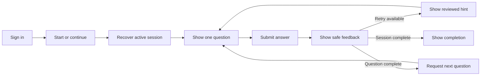
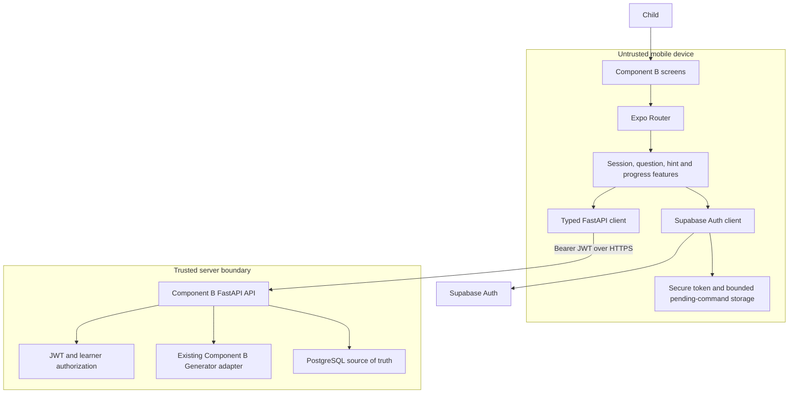
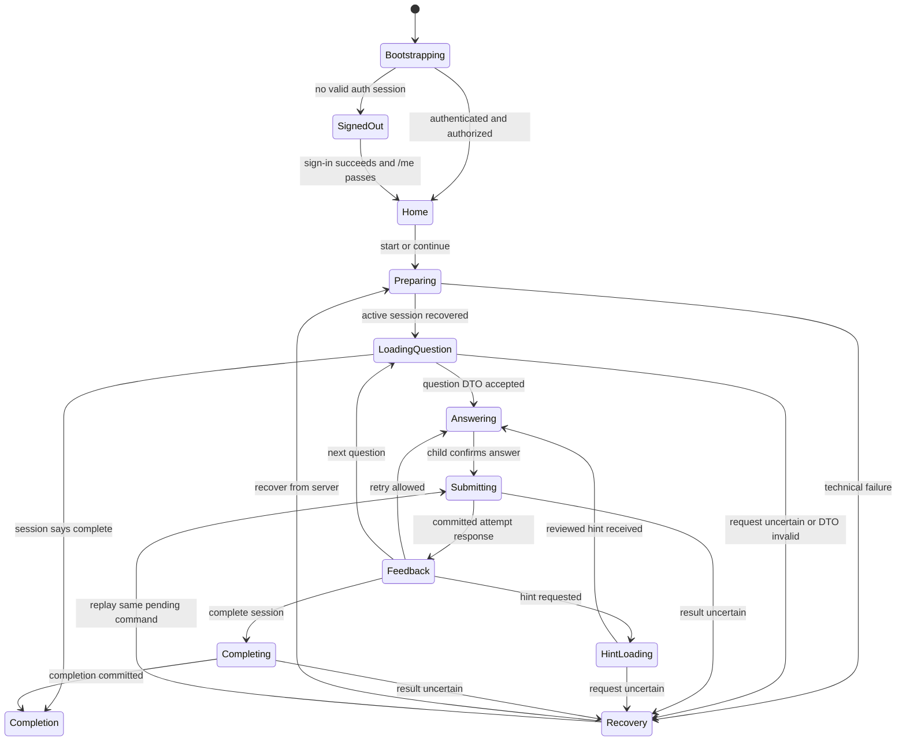

# Component B Frontend Architecture

| Field | Value |
|---|---|
| Project | R26-IT-138 adaptive mathematics platform |
| Application | Component B child-facing mobile frontend |
| Location | `Dev/frontend/` |
| Framework baseline | React Native with Expo SDK 54 and Expo Router |
| Document location | `Dev/frontend.md` |
| Version | 1.0 |
| Date | 21 July 2026 |
| Scope | Component B frontend only |
| Status | Implementation architecture and frontend/API contract baseline |

## 1. Purpose

This document is the source of truth for building the first mobile frontend around Component B.

Component B is a mathematics question engine for Grade 2 and Grade 3 learners. The mobile application presents one question at a time, captures the child's real response, requests approved hints, displays neutral feedback, and shows child-safe progress. The FastAPI backend and existing Component B Generator remain authoritative for all mathematical and scientific decisions.

This frontend must support the following learning loop:



The frontend is a presentation and interaction client. It is not a second implementation of the mathematics engine.

## 2. Source Authority

This document is derived primarily from `../componantBArchi.md`, especially its Component B scope, frontend rules, API catalogue, session lifecycle, hint lifecycle, first-attempt BKT invariant, safety rules, and mobile test requirements.

The renderer inventory was checked against the current generator under:

- `../../Yass/Implementation_v1.0/component_b_generator/samplers/`;
- `../../Yass/Implementation_v1.0/component_b_generator/models/task_instance.py`;
- `../../Yass/Component_B_v1.0/R26-IT-138_Component_B_Item_and_Task_Set_Catalogue_v1.0.md`.

The frontend baseline was checked against the installed files in `Dev/frontend/`.

When documents or code disagree, use this order:

1. approved governance decisions and frozen contracts;
2. the active Component B Generator specification;
3. active generator code and tests;
4. `componantBArchi.md`;
5. this frontend architecture;
6. older architecture proposals and historical planning text.

The active generator code is important because its currently implemented response-format vocabulary is narrower and more concrete than the full catalogue vocabulary.

## 3. Scope Boundary

### 3.1 Included now

- Supabase sign-in and secure session restoration.
- Authentication gate and protected learner routes.
- Component B home screen with Start or Continue.
- Component B session preparation and recovery.
- One-question-at-a-time learning experience.
- Renderer registry for every currently implemented Component B response format.
- Real answer submission to FastAPI.
- Deterministic, server-returned L1-L3 hints.
- Bounded retry flow.
- Neutral correct, retry, and completion feedback.
- Child-safe progress and session completion.
- Idempotent retry after transient network failures.
- Accessibility and child-safety controls.
- Typed API contracts, error mapping, and privacy-safe diagnostics.

### 3.2 Explicitly excluded now

- Component C routes, screens, API clients, games, or policies.
- Component 3 routes, screens, predictions, or reports.
- Guardian, teacher, administrator, or research dashboards.
- Clinical or diagnostic labels.
- A live LLM or external hint service.
- Client-side answer evaluation.
- Client-side BKT calculations or mastery updates.
- Client-side question selection or prerequisite logic.
- Offline generation of questions, hints, feedback, or mastery.
- Raw mastery probabilities in the child interface.
- Scientific configuration or parameter editing.

### 3.3 Future Component C integration

Component C will be added later to the same broader platform, but no Component C code is created during the Component B frontend build. Future integration should add a separate feature and route boundary without changing the Component B question, attempt, hint, or mastery client contracts.

The frontend must not call or reproduce the B-to-C adapter. Component B-to-C transfer is a backend responsibility.

## 4. Non-Negotiable Component B Rules

The frontend implementation must preserve these rules:

1. The server is authoritative for session state, question selection, timing, answer evaluation, hint level, attempts remaining, BKT, mastery, and progress.
2. Only the first attempt for an opportunity becomes a BKT observation.
3. Hints and later retries support learning but never create additional BKT observations.
4. A network or server failure is a technical event and must never be shown or recorded as a wrong answer.
5. An already-open question is recovered; it is not silently replaced.
6. Commands are retried only with the same idempotency key and identical request body.
7. The correct answer, accepted equivalence rules, distractor-rule IDs, BKT parameters, sequencing scores, and synthetic learner variables never enter frontend state.
8. Hint text is returned from the reviewed catalogue. The frontend never writes or generates a new hint.
9. Unknown response formats fail closed with a safe recovery screen; they do not fall back to a generic text box.
10. The child never sees population labels, dyscalculia subtype labels, raw mastery probabilities, rankings, or deficit language.

## 5. Current Frontend Baseline

The clean scaffold currently contains:

| Item | Current value |
|---|---|
| Expo | `~54.0.35` |
| Expo Router | `~6.0.24` |
| React Native | `0.81.5` |
| React | `19.1.0` |
| TypeScript | `~5.9.2` |
| Navigation | File-based Expo Router scaffold |
| Current screens | Default template tabs and modal only |
| Verification | Expo Doctor 18/18 and `tsc --noEmit` passed before application work |

The template screens are placeholders. They are not part of the Component B design and should be replaced deliberately when implementation begins.

All additional Expo native packages must be installed with `npx.cmd expo install ...` so versions remain compatible with SDK 54. Do not use `npm audit fix --force`.

## 6. System Context and Trust Boundary



Trust rules:

- Every identifier and answer from the device is untrusted input.
- The app may call Supabase directly only for authentication.
- All learning operations go through FastAPI.
- The Supabase service-role key is server-only.
- `EXPO_PUBLIC_*` values are visible in the built application and therefore must never contain secrets.
- The app stores the minimum data required to authenticate, render the current question, and retry one pending command safely.

## 7. Frontend Architectural Style

Use a feature-oriented Expo Router application with four layers:

1. **Routes** select screens and enforce navigation boundaries.
2. **Features** implement the child interaction flows.
3. **Domain contracts** define safe frontend DTOs and state machines.
4. **Infrastructure** provides Supabase authentication, FastAPI communication, secure storage, configuration, and privacy-safe telemetry.

Dependency direction:

```text
app routes
    -> feature screens and hooks
        -> domain contracts and policies
        -> infrastructure ports
            -> Supabase, Fetch API, SecureStore
```

Rules:

- Route files remain thin.
- Renderers depend on frontend question contracts, not directly on the API transport.
- Feature components never call `fetch` directly.
- The API layer never displays UI messages directly.
- Server DTOs are validated and mapped before entering feature state.
- Scientific behavior is never encoded in hooks, components, reducers, or local storage.

## 8. Proposed Directory Structure

This is the target structure inside `Dev/frontend/`. Create it incrementally; this document does not itself create these directories.

```text
Dev/frontend/
|-- app/
|   |-- _layout.tsx                       # providers and root navigation
|   |-- index.tsx                         # bootstrap redirect only
|   |-- (auth)/
|   |   |-- _layout.tsx
|   |   `-- sign-in.tsx
|   `-- (learner)/
|       |-- _layout.tsx                   # authenticated learner guard
|       |-- home.tsx
|       |-- prepare.tsx
|       |-- session/
|       |   `-- [sessionId].tsx           # question, hint and feedback flow
|       |-- completion.tsx
|       `-- recovery.tsx
|-- src/
|   |-- api/
|   |   |-- client.ts                     # headers, timeout, JSON and auth retry
|   |   |-- component-b-api.ts            # endpoint functions only
|   |   |-- contracts.ts                  # request and response DTOs
|   |   |-- errors.ts                     # error envelope and code mapping
|   |   `-- runtime-validation.ts          # DTO boundary validation
|   |-- auth/
|   |   |-- auth-provider.tsx
|   |   |-- auth-service.ts
|   |   |-- secure-session-store.ts
|   |   `-- use-auth.ts
|   |-- features/
|   |   |-- home/
|   |   |-- session/
|   |   |   |-- session-machine.ts
|   |   |   |-- session-screen.tsx
|   |   |   `-- use-component-b-session.ts
|   |   |-- question/
|   |   |   |-- question-card.tsx
|   |   |   |-- renderer-registry.ts
|   |   |   `-- renderers/
|   |   |       |-- integer-renderer.tsx
|   |   |       |-- choice-renderer.tsx
|   |   |       |-- relation-renderer.tsx
|   |   |       |-- ordered-list-renderer.tsx
|   |   |       |-- expanded-form-renderer.tsx
|   |   |       `-- set-selection-renderer.tsx
|   |   |-- attempts/
|   |   |   |-- answer-codec.ts
|   |   |   |-- attempt-controller.ts
|   |   |   `-- pending-command-store.ts
|   |   |-- hints/
|   |   |-- feedback/
|   |   `-- progress/
|   |-- components/
|   |   |-- app-button.tsx
|   |   |-- app-text.tsx
|   |   |-- screen-shell.tsx
|   |   |-- loading-state.tsx
|   |   `-- safe-error-state.tsx
|   |-- config/
|   |   |-- env.ts
|   |   `-- app-version.ts
|   |-- storage/
|   |   `-- secure-store.ts
|   |-- theme/
|   |   |-- colors.ts
|   |   |-- spacing.ts
|   |   |-- typography.ts
|   |   `-- tokens.ts
|   |-- telemetry/
|   |   `-- safe-events.ts
|   `-- test/
|       |-- fixtures/
|       `-- render.tsx
|-- assets/
|-- app.json
|-- package.json
`-- tsconfig.json
```

No `component-c`, `component-3`, teacher-dashboard, guardian-dashboard, or research-export folder belongs in this first frontend.

## 9. Navigation and Screen Responsibilities

| Route | Screen responsibility | Allowed API calls |
|---|---|---|
| `/` | Restore authentication and choose the correct route | Supabase session restore, then `GET /api/v1/me` |
| `/(auth)/sign-in` | Authenticate an approved user | Supabase Auth only |
| `/(learner)/home` | Show Start or Continue and child-safe last progress | `POST /api/v1/b/sessions`, `GET /api/v1/b/progress` |
| `/(learner)/prepare` | Check readiness, start/resume, then load current state | `GET /health/ready`, session start/recovery |
| `/(learner)/session/[sessionId]` | Render question, submit answer, request hint, show feedback | question, attempt, hint and recovery endpoints |
| `/(learner)/completion` | Show safe completed-session summary | completion response and `GET /api/v1/b/progress` |
| `/(learner)/recovery` | Explain a technical interruption and retry safely | recovery query or replay of the same command |

### 9.1 Route protection

- Unauthenticated users may access only the authentication group.
- Authenticated users are verified through `GET /api/v1/me` before learner routes render.
- A token existing on the device is not sufficient proof of authorization.
- A 401 after one controlled refresh attempt clears protected state and returns to sign-in.
- A 403 does not retry automatically and shows a supervisor-safe access message.
- Deep links into a session route must recover the session from the server; route parameters alone never authorize access.

### 9.2 Session screen composition

The session route is one stable screen rather than a separate navigation route for every attempt. It contains:

- session progress header without raw mastery;
- prompt and approved visual representation;
- exactly one renderer chosen by `response_format`;
- one primary Submit action;
- an inline hint panel when returned;
- neutral feedback;
- retry or next-question action determined by `next_action`;
- a blocking technical-recovery state when the server result is uncertain.

This avoids accidental navigation that could replace an open question.

## 10. Frontend Session State Machine



The frontend state machine never contains a transition called `updateMastery`. Mastery is a backend effect of a valid first-attempt transaction.

## 11. State Ownership and Storage

| Data | Location | Authority | Persistence rule |
|---|---|---|---|
| Access and refresh tokens | Secure native storage | Supabase Auth/backend validation | Persist securely; clear on sign-out or unrecoverable refresh failure |
| Authenticated user/learner view | Memory | `GET /api/v1/me` | Re-fetch on bootstrap |
| Current route | Expo Router | Client | Reconstructed from auth and server state |
| Current session DTO | Memory/query cache | FastAPI | Non-authoritative; recover by session GET |
| Open question safe DTO | Memory plus bounded secure recovery cache if required | FastAPI | Replace only when server returns a new opportunity ID |
| Current unsent answer | Component memory | Child/client | Clear only after committed response or explicit discard |
| One pending command | Bounded secure store | FastAPI on replay | Same key and byte-equivalent body until resolved |
| Hint content | Memory with current opportunity | FastAPI/catalogue | Clear when opportunity changes |
| Feedback | Memory | FastAPI | Never infer correctness locally |
| Progress | Query cache | FastAPI | Child-safe fields only |
| Answer key | Nowhere in frontend | Backend/engine | Never received or stored |
| BKT and sequencing settings | Nowhere in frontend | Backend/engine | Never received or stored |

### 11.1 Pending-command rule

Only one learning command should normally be in flight because the child experience has one primary action. The pending record contains:

```ts
type PendingCommand = {
  kind: 'start_session' | 'next_question' | 'submit_attempt' | 'request_hint' | 'complete_session';
  endpoint: string;
  idempotencyKey: string;
  clientEventId: string;
  body: unknown;
  createdAt: string;
  sessionId?: string;
  opportunityId?: string;
};
```

The queue is bounded, encrypted/native, and cleared only after a confirmed success or a server response proving that the operation cannot be replayed. Raw answers must never be placed in logs, analytics, URLs, or ordinary AsyncStorage.

## 12. Configuration

The frontend may use these public build-time variables:

| Variable | Purpose | Secret? |
|---|---|---:|
| `EXPO_PUBLIC_API_BASE_URL` | FastAPI origin, such as `https://api.example.org` | No |
| `EXPO_PUBLIC_SUPABASE_URL` | Supabase project URL | No |
| `EXPO_PUBLIC_SUPABASE_PUBLISHABLE_KEY` | Public client key for Supabase Auth | No |
| `EXPO_PUBLIC_APP_ENV` | `development`, `staging`, or `production` | No |

Rules:

- Validate configuration during app bootstrap.
- Reject missing or malformed URLs before allowing sign-in.
- Production must require HTTPS.
- Do not place a service-role key, database password, JWT signing secret, answer key, BKT value, or scientific configuration in `.env` or the Expo bundle.
- Do not commit real environment files. Commit only a redacted `.env.example` when configuration work begins.
- The backend base URL has no trailing `/`; endpoint functions append versioned paths.

## 13. FastAPI Client Conventions

### 13.1 Base paths

- Identity: `/api/v1/me`
- Component B learning API: `/api/v1/b`
- Operations: `/health/live` and `/health/ready`

The frontend does not call PostgreSQL, Supabase tables, or the Component B Generator directly.

### 13.2 Standard request headers

```http
Authorization: Bearer <supabase-access-token>
Content-Type: application/json
Accept: application/json
X-Mobile-App-Version: 1.0.0
Idempotency-Key: <opaque-uuid-for-this-command>
```

`Idempotency-Key` is required for every state-changing FastAPI command. A replay uses the same key and identical body. A new child action uses a new key.

### 13.3 Standard response behavior

- JSON only for v1 domain responses.
- All timestamps are UTC ISO 8601 strings.
- Identifiers are opaque strings/UUIDs.
- Successful responses carry or expose a request ID for support correlation.
- Non-success responses use the stable error envelope in section 16.
- Unknown fields on scientific command requests should be rejected by the backend.
- The client performs runtime validation before a response enters feature state.

### 13.4 API client responsibilities

The centralized client must:

1. build the full URL;
2. attach the current access token;
3. attach app version and idempotency headers;
4. apply a bounded request timeout;
5. parse JSON safely;
6. capture the request ID without logging the answer;
7. map HTTP and domain errors;
8. refresh authentication once on an eligible 401;
9. never automatically replay a command with a new idempotency key;
10. return typed results to feature hooks.

## 14. Component B Endpoint Catalogue

| Method and route | Called from | Idempotency | Purpose |
|---|---|---:|---|
| `GET /api/v1/me` | Bootstrap/auth gate | No | Resolve current authorized learner |
| `POST /api/v1/b/sessions` | Home/preparation | Yes | Start or safely resume a B session |
| `GET /api/v1/b/sessions/{session_id}` | Bootstrap/recovery | No | Recover authoritative session state |
| `POST /api/v1/b/sessions/{session_id}/questions/next` | Session screen | Yes | Issue or replay the open question |
| `POST /api/v1/b/sessions/{session_id}/questions/{opportunity_id}/attempts` | Session screen | Yes | Submit one real bounded attempt |
| `POST /api/v1/b/sessions/{session_id}/questions/{opportunity_id}/hints` | Session screen | Yes | Request the next approved hint |
| `POST /api/v1/b/sessions/{session_id}/complete` | Session screen | Yes | Complete the eligible B session |
| `GET /api/v1/b/progress` | Home/completion | No | Return child-safe progress |
| `GET /health/live` | Diagnostics | No | Process liveness |
| `GET /health/ready` | Preparation/operations | No | Database and generator readiness |

The schemas below are the frontend-facing v1 contract to implement with the FastAPI backend. They specialize the fields required by `componantBArchi.md` without exposing scientific internals.

## 15. API Contracts

### 15.1 Shared primitive types

```ts
type UtcTimestamp = string;
type OpaqueId = string;
type Grade = 2 | 3;

type SkillId =
  | 'counting'
  | 'number_sense'
  | 'place_value'
  | 'addition'
  | 'subtraction'
  | 'multiplication'
  | 'division';

type SessionState =
  | 'starting'
  | 'active'
  | 'completing'
  | 'completed'
  | 'abandoned'
  | 'expired'
  | 'technical_failed';
```

The exact string values must be shared with backend OpenAPI and contract tests. The frontend should generate or check types from that contract once FastAPI exists rather than maintaining silent duplicates forever.

### 15.2 `GET /api/v1/me`

Purpose: verify the token and resolve the learner that the current app session may operate.

Proposed safe response:

```ts
type MeResponse = {
  user_id: OpaqueId;
  roles: Array<'learner' | 'supervisor' | 'operator'>;
  learner: {
    learner_id: OpaqueId;
    grade: Grade;
    active: boolean;
    display_name?: string;
  } | null;
  request_id: string;
};
```

Frontend behavior:

- Require an active learner before showing the Component B learner home.
- Treat roles as display/navigation input only; the backend reauthorizes every request.
- Do not cache server-controlled authorization as permanent device truth.
- Do not request or store clinical, population, or subtype information.

### 15.3 `POST /api/v1/b/sessions`

Purpose: start a new Component B session or return the learner's existing active session.

Request:

```ts
type StartSessionRequest = {
  client_timezone: string;
  mobile_app_version: string;
};
```

The learner is derived from the verified token; the frontend must not choose an arbitrary learner ID.

Response:

```ts
type StartSessionResponse = {
  b_session_id: OpaqueId;
  session_number: number;
  state: SessionState;
  resume: boolean;
  current_opportunity_id: OpaqueId | null;
  runtime_bundle_version: string;
  expires_at: UtcTimestamp;
  request_id: string;
};
```

Frontend behavior:

- Persist the command before sending it.
- If `resume` is true, recover the returned session rather than starting a second one.
- Never show `runtime_bundle_version` to the child; retain it only for safe diagnostics.

### 15.4 `GET /api/v1/b/sessions/{session_id}`

Purpose: recover state after navigation, app restart, or an uncertain command result.

Response:

```ts
type RecoverSessionResponse = {
  b_session_id: OpaqueId;
  session_number: number;
  state: SessionState;
  next_action:
    | 'request_question'
    | 'answer_question'
    | 'retry_answer'
    | 'request_hint'
    | 'complete_session'
    | 'view_completion'
    | 'contact_supervisor';
  open_question: QuestionDto | null;
  current_hint: HintDto | null;
  runtime_bundle_version: string;
  expires_at: UtcTimestamp;
  request_id: string;
};
```

Recovery rules:

- If `open_question` exists, show exactly that opportunity.
- Do not call `questions/next` merely because local state was lost.
- Recovery must not submit an answer, request a hint, advance an item, or update mastery.
- Terminal states route to completion or a safe supervisor/technical message.

### 15.5 `POST /api/v1/b/sessions/{session_id}/questions/next`

Purpose: issue the next selected question or replay the already-open question.

Request body:

```json
{}
```

Response:

```ts
type QuestionDto = {
  opportunity_id: OpaqueId;
  item_index: number;
  skill_id: SkillId;
  item_template_id: string;
  prompt: SafePrompt;
  response_format: ImplementedResponseFormat;
  input_constraints: InputConstraints;
  options: SafeOption[] | null;
  hint_available: boolean;
  attempt_index: number;
  attempts_remaining: number;
  issued_at: UtcTimestamp;
  presentation_token: string;
};

type NextQuestionResponse = QuestionDto & {
  request_id: string;
};
```

Rules:

- A repeated request while a question is open returns the same `opportunity_id`.
- `presentation_token` is opaque and must be returned only with the matching attempt.
- The frontend never decodes or creates the token.
- `item_template_id` and `skill_id` are trace fields, not instructions for solving the question.
- The response must not include `correct_answer`, equivalent answers, distractor rule IDs, generated seeds, BKT settings, or sequencing scores.

### 15.6 `POST /api/v1/b/sessions/{session_id}/questions/{opportunity_id}/attempts`

Purpose: submit the child's real answer for authoritative evaluation.

Request:

```ts
type SubmitAttemptRequest = {
  submitted_answer: SubmittedAnswer;
  attempt_index: number;
  presentation_token: string;
  client_event_id: string;
  client_elapsed_ms?: number;
};
```

Response:

```ts
type SubmitAttemptResponse = {
  attempt_id: OpaqueId;
  is_correct: boolean;
  feedback_code: string;
  attempt_status:
    | 'retry_available'
    | 'completed_correct'
    | 'completed_incorrect';
  attempts_remaining: number;
  hint_available: boolean;
  next_action:
    | 'retry'
    | 'request_hint'
    | 'next_question'
    | 'complete_session';
  request_id: string;
};
```

Frontend behavior:

1. Validate only shape and UI bounds; do not validate mathematical correctness.
2. Disable duplicate taps while the command is in flight.
3. Keep the answer and exact command record until success is confirmed.
4. Render correctness only from `is_correct` and `feedback_code`.
5. Follow `next_action`; do not infer the next step from attempt count.
6. Do not display or calculate a mastery change.

`client_elapsed_ms` is supporting monotonic telemetry. The backend derives authoritative response time from server-controlled timestamps.

### 15.7 `POST /api/v1/b/sessions/{session_id}/questions/{opportunity_id}/hints`

Purpose: request the next permitted reviewed hint.

Request:

```ts
type RequestHintRequest = {
  attempt_index: number;
  client_event_id: string;
};
```

Response:

```ts
type HintDto = {
  hint_event_id: OpaqueId;
  hint_level: 1 | 2 | 3;
  content: HintContentBlock[];
  applies_to_attempt_index: number;
};

type RequestHintResponse = HintDto & {
  request_id: string;
};
```

Rules:

- Show exactly the returned content.
- Do not paraphrase, expand, translate, or generate hint text at runtime.
- A duplicate request with the same idempotency key returns the same hint event.
- Hint display does not alter local or server mastery.
- The UI must not expose a hint button when `hint_available` is false.

### 15.8 `POST /api/v1/b/sessions/{session_id}/complete`

Purpose: complete a session only when the backend policy says it is eligible.

Request body:

```json
{}
```

Response:

```ts
type SafeSessionSummary = {
  questions_completed: number;
  encouraging_message_code: string;
  skill_progress: SafeSkillProgress[];
};

type CompleteSessionResponse = {
  b_session_id: OpaqueId;
  state: 'completed';
  completed_at: UtcTimestamp;
  summary: SafeSessionSummary;
  request_id: string;
};
```

The frontend does not receive or publish B-to-C or Component-3 payloads.

### 15.9 `GET /api/v1/b/progress`

Purpose: return a child-safe, non-diagnostic view of progress.

```ts
type SafeSkillProgress = {
  skill_id: SkillId;
  label: string;
  state: 'not_started' | 'practising' | 'growing' | 'ready';
};

type ProgressResponse = {
  completed_sessions: number;
  skills: SafeSkillProgress[];
  latest_completed_at: UtcTimestamp | null;
  request_id: string;
};
```

The backend maps scientific state to these safe labels. The frontend must not derive them from a probability.

### 15.10 Health endpoints

`GET /health/live` answers whether the API process is alive. `GET /health/ready` answers whether the database, migrations, generator, catalogue, configuration, and required storage are ready.

The learner UI should normally use readiness only during session preparation or recovery. It must not continuously poll operational endpoints during a question.

## 16. Error Contract and Recovery Policy

### 16.1 Error envelope

```ts
type ApiFieldIssue = {
  field: string;
  code: string;
};

type ApiErrorEnvelope = {
  code: string;
  message: string;
  request_id: string;
  retryable: boolean;
  details?: ApiFieldIssue[];
};
```

The frontend maps stable `code` values to reviewed UI messages. It does not display stack traces, raw exceptions, database errors, scientific parameters, or the submitted answer in an error report.

### 16.2 HTTP handling

| Status | Meaning | Frontend action |
|---:|---|---|
| 400/422 | Invalid request shape or bounds | Keep input, show safe correction, do not auto-retry |
| 401 | Missing, expired, or invalid token | Attempt one controlled refresh; otherwise sign out |
| 403 | Learner not authorized | Stop and show supervisor-safe access message |
| 404 | Resource absent or concealed | Recover active session from home |
| 409 | Lifecycle, attempt-index, or idempotency conflict | Do not create a new key; recover session state |
| 412 | App or resource version precondition failed | Require update or recover latest state |
| 429 | Rate limited | Respect server delay and prevent repeated taps |
| 500 | Unexpected server failure | Preserve input and show request ID |
| 503 | Backend dependency or scientific bundle unavailable | Pause; never mark answer wrong; retry only if allowed |

### 16.3 Retry matrix

| Operation | Automatic retry? | Requirement |
|---|---:|---|
| `GET /me`, session recovery, progress | Yes, bounded | Jittered retry for network/5xx only |
| Start session | Only after uncertain transport failure | Same idempotency key and identical body |
| Next question | Only after uncertain transport failure | Same idempotency key and identical body |
| Submit attempt | Never with a new key | Preserve exact command; replay same key or recover session |
| Request hint | Never with a new key | Preserve exact command; replay same key or recover session |
| Complete session | Never with a new key | Replay same key or recover session |
| 400, 401 after refresh, 403, 409, 412 | No blind retry | Follow explicit recovery policy |

If the client cannot determine whether a submission committed, it first recovers the session. It must never send the same answer as a new attempt merely because the first response was lost.

## 17. Safe Question Presentation Contract

### 17.1 Prompt model

The current generator produces a `prompt` dictionary with reviewed stems and structured representation values. The FastAPI adapter must map this private generator structure to a safe, versioned presentation DTO.

```ts
type SafePrompt = {
  stem: string;
  blocks: PromptBlock[];
};

type PromptBlock =
  | { type: 'text'; text: string }
  | { type: 'equation'; left: number; operator: '+' | '-' | 'x' | '/'; right: number }
  | { type: 'object_set'; count: number; set_id?: 'a' | 'b' }
  | { type: 'number_sequence'; values: number[]; blank_position: number }
  | { type: 'number_cards'; values: number[]; direction: 'ascending' | 'descending' }
  | { type: 'place_value'; number: number; places: Array<'hundreds' | 'tens' | 'ones'> }
  | { type: 'approved_image'; uri: string; alt: string };
```

The backend owns this mapping. It must not forward the generator's full private task instance, generated operands, correct answer, equivalence list, seeds, or distractor evidence.

### 17.2 Options

```ts
type SafeOption = {
  option_id: string;
  label: string;
  content: string | number;
};
```

Option order is server supplied and remains stable for the open opportunity. The frontend submits the selected `option_id` or the contract-approved visible value; it never receives which option is correct.

### 17.3 Input constraints

```ts
type InputConstraints = {
  required: true;
  min_value?: number;
  max_value?: number;
  max_length?: number;
  min_selections?: number;
  max_selections?: number;
  item_count?: number;
  allowed_symbols?: string[];
};
```

Constraints protect usability and payload size. They do not tell the child whether an answer is mathematically correct.

## 18. Renderer Registry

### 18.1 Current implemented generator formats

The current generator sampler registry uses these nine response formats:

1. `single_integer`
2. `single_integer_or_choice`
3. `single_choice`
4. `relation_choice`
5. `ordered_list`
6. `binary_or_choice`
7. `single_choice_or_integer`
8. `expanded_form`
9. `interactive_set_selection`

```ts
type ImplementedResponseFormat =
  | 'single_integer'
  | 'single_integer_or_choice'
  | 'single_choice'
  | 'relation_choice'
  | 'ordered_list'
  | 'binary_or_choice'
  | 'single_choice_or_integer'
  | 'expanded_form'
  | 'interactive_set_selection';
```

The authoritative catalogue also defines forward-looking formats such as `ordered_integer_sequence`, `single_mark_choice`, `single_integer_or_mark`, `structured_pair`, `structured_triple_or_expression`, and `structured_exchange`. Those must not be declared supported merely because they exist in the catalogue. Add a renderer only when its template is activated, its safe API shape is frozen, and renderer contract tests pass.

### 18.2 Renderer mapping

| Response format | Renderer | Submitted answer shape |
|---|---|---|
| `single_integer` | Integer keypad/input | `{ kind: "integer", value: number }` |
| `single_integer_or_choice` | Server-selected integer or choice mode | Integer or option answer |
| `single_choice` | Large choice cards | `{ kind: "option", option_id: string }` |
| `relation_choice` | `<`, `>`, `=` controls | `{ kind: "relation", value: "<" | ">" | "=" }` |
| `ordered_list` | Tap-to-order number cards | `{ kind: "ordered_integers", values: number[] }` |
| `binary_or_choice` | Two large choice cards | Option answer |
| `single_choice_or_integer` | Server-selected choice or integer mode | Option or integer answer |
| `expanded_form` | Place-value fields | `{ kind: "expanded_form", hundreds?, tens, ones }` |
| `interactive_set_selection` | Tap objects to select a set | `{ kind: "set_selection", selected_ids: string[] }` |

```ts
type SubmittedAnswer =
  | { kind: 'integer'; value: number }
  | { kind: 'option'; option_id: string }
  | { kind: 'relation'; value: '<' | '>' | '=' }
  | { kind: 'ordered_integers'; values: number[] }
  | { kind: 'expanded_form'; hundreds?: number; tens: number; ones: number }
  | { kind: 'set_selection'; selected_ids: string[] };
```

The FastAPI adapter maps this public union into the existing answer normalization and equivalence functions.

### 18.3 Renderer interface

```ts
type QuestionRendererProps = {
  question: QuestionDto;
  disabled: boolean;
  value: SubmittedAnswer | null;
  onChange: (answer: SubmittedAnswer) => void;
  onSubmit: () => void;
};

type RendererRegistry = Record<
  ImplementedResponseFormat,
  React.ComponentType<QuestionRendererProps>
>;
```

Every renderer must:

- show only the supplied safe prompt and options;
- expose one clear input method;
- prevent submission when required input is absent;
- obey input size and selection bounds;
- support screen readers and keyboard/focus navigation where applicable;
- use non-color selection and feedback indicators;
- preserve the current answer during a transient request failure;
- contain no answer key or template-specific correctness rule.

### 18.4 Fail-closed behavior

If the server returns an unknown response format, malformed prompt block, or unsafe option shape:

1. do not render a generic answer field;
2. do not submit an answer;
3. record a privacy-safe contract error with request ID and format name only;
4. show a child-safe technical interruption;
5. recover or stop the session through the backend.

## 19. Answer, Hint, and Feedback Flow

### 19.1 Answer submission

1. The question appears and a monotonic client timer starts for supporting telemetry.
2. The child creates an answer through the selected renderer.
3. Submit becomes enabled only when the answer shape is complete.
4. A new `client_event_id` and idempotency key are created once.
5. The exact pending command is stored before network transmission.
6. The UI prevents duplicate taps while the command is unresolved.
7. The backend evaluates the answer and commits the attempt.
8. The frontend clears the pending command only after a confirmed response.
9. Feedback is chosen from `feedback_code` and `next_action`.

### 19.2 Hint behavior

- Hint is an inline panel; it does not navigate away from the question.
- The child requests a hint explicitly when the backend permits it.
- The backend decides whether L1, L2, or L3 is next.
- The frontend shows the returned catalogue content exactly.
- Hint content remains visible for the applicable retry.
- Requesting or viewing a hint never changes mastery in the frontend.

### 19.3 Feedback behavior

Feedback is supportive and neutral:

- correct: acknowledge effort and enable the server-directed next action;
- retry: encourage another attempt without giving the answer;
- completed incorrect: close the opportunity using the server's safe message;
- technical failure: say progress was not lost and offer recovery.

Do not use shame language, ranking, red-only failure signals, clinical terms, or mastery percentages.

## 20. Authentication Architecture

### 20.1 Responsibilities

Supabase Auth:

- authenticates the approved user;
- issues access and refresh tokens;
- refreshes or revokes the session.

Expo app:

- stores token material in secure native storage;
- restores tokens during bootstrap;
- sends the access token to FastAPI;
- clears protected state after unrecoverable authentication failure.

FastAPI:

- verifies JWT signature, issuer, audience, expiry, and subject;
- maps the subject to server-controlled roles and learner relationships;
- authorizes every Component B resource;
- rejects cross-learner access.

### 20.2 Token rules

- Never store tokens in ordinary AsyncStorage, logs, URLs, analytics, screenshots, or error messages.
- Never place the service-role key in the Expo app.
- Keep the authenticated session in memory after secure restoration.
- Handle SecureStore size or availability failures explicitly and fail closed.
- Clear tokens and pending protected state on sign-out.
- Do not decide authorization from editable Supabase user metadata.

## 21. Accessibility and Child-Safe UX

Minimum requirements:

- one question and one primary action per screen;
- portrait-first layout with responsive tablet support;
- large touch targets, adequate spacing, and readable typography;
- screen-reader labels for prompts, options, selected state, hint, and feedback;
- predictable focus order and focus movement after feedback/hint updates;
- no color-only meaning;
- reduced-motion support for celebrations and transitions;
- minimal reading load and consistent wording;
- reviewed visual alternatives and descriptive text;
- numeric keyboards where appropriate without blocking hardware keyboard use;
- protection from accidental double submission;
- no countdown pressure unless separately governed and approved.

Child-facing content must be reviewed independently of this technical document.

## 22. Security and Privacy

### 22.1 Data minimization

The frontend needs only:

- opaque user, learner, session, opportunity, attempt, and hint identifiers;
- grade and active status;
- safe question presentation data;
- answer input while needed for submission/recovery;
- safe feedback and progress labels;
- request IDs and public runtime/app version identifiers for diagnostics.

It does not need names beyond an optional approved display name, research exports, diagnoses, population labels, full engine task instances, exact mastery, or scientific configuration.

### 22.2 Logging prohibition

Never log:

- access or refresh tokens;
- authorization headers;
- submitted answers;
- full question DTOs or hint content;
- child names or contact information;
- answer keys or scientific parameters;
- secure-storage contents.

Privacy-safe telemetry may include app version, route template, response status, duration, stable error code, retry result, and request ID.

### 22.3 Mobile threat controls

- All production traffic uses valid TLS.
- Identifiers never replace backend authorization.
- Presentation tokens bind attempts to issued questions.
- Idempotency prevents duplicate learning events.
- Input constraints bound payload size.
- Signed production builds and dependency review are required.
- The client assumes it can be inspected or modified and therefore holds no scientific secret.

## 23. Testing Strategy

### 23.1 Contract tests

- Every endpoint request matches the FastAPI/OpenAPI schema.
- Safe question DTOs reject forbidden fields.
- Every implemented `response_format` maps to exactly one renderer.
- Unknown formats fail closed.
- Error envelopes map to reviewed recovery behavior.
- Idempotent command replay keeps the same key and identical body.

### 23.2 Unit and component tests

- Each renderer creates the correct `SubmittedAnswer` shape.
- Required input and bounds are enforced without checking correctness.
- Hint content displays exactly as returned.
- Feedback follows `next_action`.
- Duplicate taps create one pending command.
- A transient failure preserves the current answer.
- No scientific internal field enters stored client state.
- Auth refresh runs at most once for one failed request.

### 23.3 Accessibility tests

- Screen-reader labels and reading order.
- Minimum target sizing and spacing.
- Visible focus.
- Non-color selection, correctness, and error states.
- Dynamic text/layout resilience.
- Reduced-motion behavior.

### 23.4 Integration tests

- Sign in and resolve authorized learner.
- Start a new Component B session.
- Resume an existing active session.
- Recover the same open question after app restart.
- Submit an incorrect first attempt and receive retry/hint state.
- Request and show the next reviewed hint.
- Submit a correct retry without any frontend mastery calculation.
- Request the next adaptively selected question.
- Complete the session and show safe progress.
- Lose the attempt response, recover, and prove the attempt was not duplicated.

### 23.5 Required verification commands

Run from `Dev/frontend/` after each implementation batch:

```powershell
npx.cmd expo-doctor@latest
npx.cmd tsc --noEmit
npm.cmd run lint
```

Add unit/component and end-to-end test commands when the test stack is installed. Do not claim those test layers pass before they exist and run.

## 24. Planned Dependencies

The current scaffold does not yet contain all application dependencies. Install only when their implementation batch begins.

| Capability | Planned package/approach |
|---|---|
| Navigation | Existing Expo Router |
| Authentication client | `@supabase/supabase-js` |
| Secure native storage | `expo-secure-store` |
| Opaque client IDs | `expo-crypto` or supported platform UUID API |
| Server-state cache | A small typed query layer; use TanStack Query only if adopted explicitly |
| Runtime DTO validation | Lightweight explicit guards or an approved schema library |
| Testing | Jest/React Native Testing Library and an approved device E2E tool |

Dependency rules:

- Use `npx.cmd expo install` for Expo/native packages.
- Use `npm.cmd install` for compatible JavaScript-only packages.
- Run Expo Doctor and TypeScript immediately after installation.
- Never run `npm audit fix --force` on the Expo application.
- Record why each dependency is necessary; do not add a broad UI or state library without a concrete requirement.

## 25. Implementation Sequence

### Batch F0 - Replace the template safely

- Remove default demo routes and components that are not reused.
- Add theme tokens, root providers, route groups, and configuration validation.
- Preserve a compiling Expo SDK 54 baseline.

**Exit:** app boots to a controlled placeholder through the new route structure.

### Batch F1 - Authentication and API foundation

- Install Supabase and SecureStore dependencies.
- Implement secure auth restoration and sign-in.
- Implement the central FastAPI client, error envelope, and `/me` gate.
- Add redacted environment example and startup validation.

**Exit:** an authorized learner reaches Home; invalid sessions return safely to sign-in.

### Batch F2 - Session start and recovery

- Implement Home, preparation, Start/Continue, and recovery.
- Add idempotency-key creation and bounded pending-command storage.
- Implement start session, recover session, and next-question APIs.

**Exit:** the app always returns to the same active session and open opportunity.

### Batch F3 - Question renderer foundation

- Implement safe prompt blocks and renderer registry.
- Implement the nine active response formats by renderer family.
- Add malformed/unknown-format fail-closed behavior.
- Add renderer contract and accessibility tests.

**Exit:** every active generator response format renders and produces a valid answer DTO.

### Batch F4 - Attempts, hints, and feedback

- Submit real answers.
- Preserve uncertain commands and replay safely.
- Implement server-directed neutral feedback.
- Implement reviewed hint display and bounded retries.

**Exit:** incorrect first attempt, hint, correct retry, and next question work without duplicate attempts or client-side mastery logic.

### Batch F5 - Completion and safe progress

- Complete eligible sessions.
- Show completion celebration with reduced-motion support.
- Add child-safe progress categories.

**Exit:** a complete Component B session works on a physical device.

### Batch F6 - Hardening

- Accessibility review.
- Network interruption and replay testing.
- Auth expiry and cross-learner authorization tests.
- Production configuration, signed builds, crash/privacy review, and device testing.

**Exit:** the standalone Component B frontend meets its acceptance tests.

## 26. Backend Contract Prerequisites

Before the frontend moves from fixtures to live FastAPI integration, the backend must provide:

- the endpoint paths in section 14;
- versioned OpenAPI schemas;
- exact response-format and submitted-answer discriminators;
- safe prompt-block and option schemas;
- a documented idempotency header and replay policy;
- stable `feedback_code`, `next_action`, and error-code vocabularies;
- session recovery that includes the existing open question;
- no answer keys or scientific internals in public DTOs;
- development and staging URLs;
- Supabase issuer/audience configuration and authorized test learner accounts;
- CORS/device-network configuration suitable for Expo development;
- request IDs on success and failure.

Fixtures must use the same public contracts and must not invent frontend-only mathematics behavior.

## 27. Definition of Ready for Frontend Implementation

Frontend implementation can begin when:

- the Expo SDK 54 baseline remains healthy;
- Component B remains the only active feature scope;
- the first implementation batch and its exit gate are accepted;
- required package installations are performed with Expo-compatible commands;
- the API contract is either available from FastAPI or represented by clearly marked fixtures;
- the renderer registry covers all nine currently implemented generator response formats;
- unknown formats fail closed;
- the server remains authoritative for all learning decisions;
- first-attempt-only BKT behavior is never duplicated in the client.

## 28. Final Frontend Decisions

| Decision | Result |
|---|---|
| Framework | React Native Expo SDK 54 with TypeScript and Expo Router |
| Current scope | Component B child frontend only |
| Backend | Versioned FastAPI Component B API |
| Authentication | Supabase Auth; FastAPI verifies and authorizes |
| Learning state authority | FastAPI and PostgreSQL |
| Scientific authority | Existing Component B Generator through backend adapter |
| Navigation | Authentication group plus protected learner group |
| Question UI | Renderer registry driven by safe `response_format` |
| Active format coverage | Nine formats from the current generator sampler registry |
| Attempts | Idempotent real-response commands |
| Timing | Server authoritative; client elapsed time is telemetry only |
| BKT | Never calculated in the frontend; first attempt only on backend |
| Hints | Exact reviewed backend/catalogue content only |
| Progress | Server-produced child-safe labels; no raw probabilities |
| Offline behavior | Preserve/replay bounded commands; no offline evaluation |
| Unknown formats | Fail closed |
| Component C | Future separate integration; no code now |
| Component 3 | Outside current scope |

This document should be updated whenever a frontend route, public DTO, response format, storage policy, or implementation batch changes. Scientific rules must be changed in their authoritative Component B specifications and backend/engine contracts first, not silently inside this frontend document.
